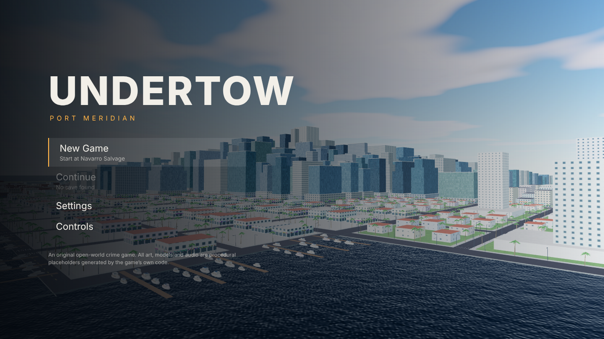
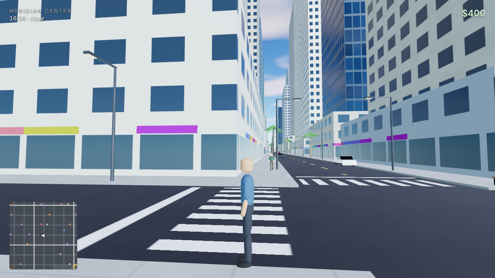
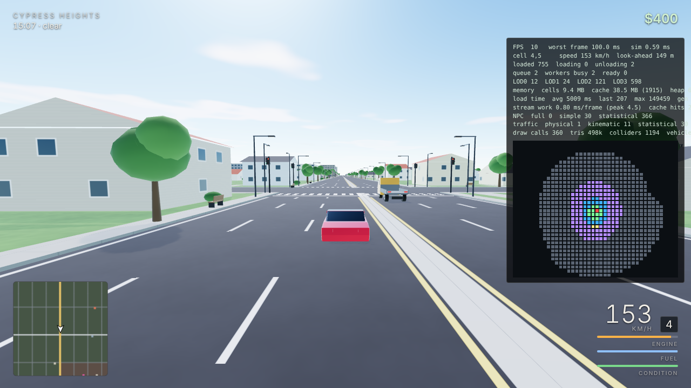
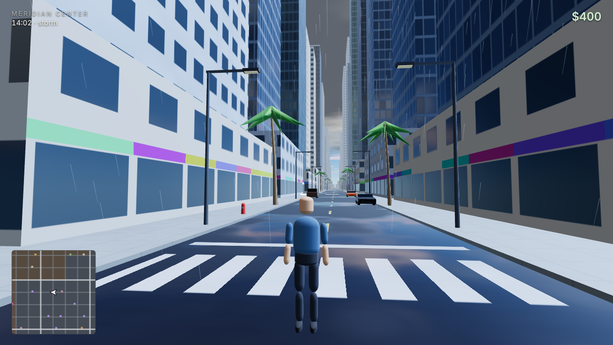
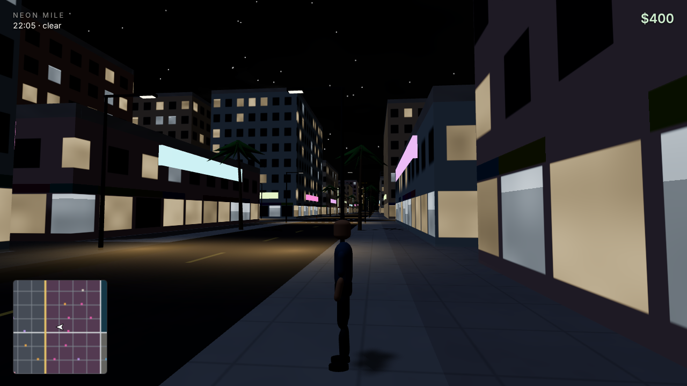
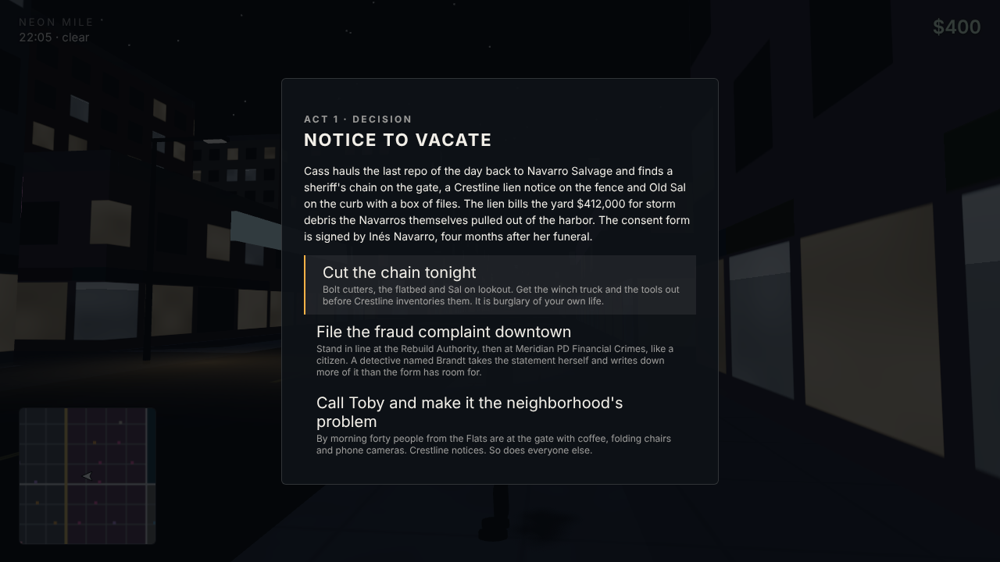
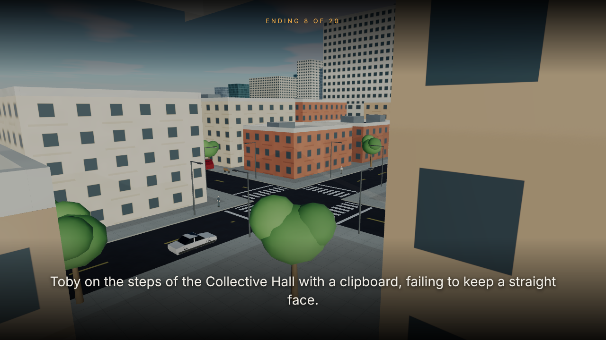

# UNDERTOW: Port Meridian

An original open-world crime game (brief working title: *Project Vice*), built in controlled
milestones. Third-person on foot and behind the wheel, in a seamless streamed coastal city, with a
branching story that ends twenty different ways.

Everything here is original: the city of Port Meridian, its characters, story, vehicles and
missions. Nothing is taken from Grand Theft Auto or any other game. All models, materials and
sounds are **procedural placeholders generated by code** — see `docs/KNOWN_LIMITATIONS.md` for an
honest account of what this is and is not.



| | |
|---|---|
|  |  |
|  |  |
|  |  |

## What is in it

- **A streamed city.** Port Meridian: twelve districts on a 4.8 × 4.0 km coast, generated in Web
  Workers and streamed around the player in 200 m cells at four levels of detail, with look-ahead
  along the direction of travel. No loading screens in play.
- **Driving.** Sedan, SUV, sports car, truck, motorcycle and boat on a physics engine, each with
  its own handling, gearbox, damage and fuel.
- **A living street.** Signal-obeying traffic, pedestrians who walk, talk, cross, shelter from
  rain, flee danger and report crimes, and a named cast with daily schedules and memory.
- **Police who have to find you.** Wanted levels come from witnesses and line of sight; units go
  to your last known position, search, and give up.
- **A branching story.** 25 story missions and 12 side jobs across 33 decision nodes, leading to
  **20 different endings**, every one proven reachable.
- **An economy.** Shops, restaurants, garages, clothing, dealerships, safehouses, businesses,
  fuel and venues — each does something real.
- **Saves** with three slots, autosave, checksums and recovery from a damaged file.

## Play

```sh
npm install
npm run dev        # http://localhost:5173
```

or build static files and serve `dist/` from any web server:

```sh
npm run build
npm run preview    # http://localhost:4173
```

A desktop browser with WebGL2 and a discrete or recent integrated GPU is recommended.

| Key | Action |
|---|---|
| W A S D | Move / steer |
| Mouse | Look (click the game to capture the pointer) |
| Shift / C / Space | Sprint / crouch / jump (handbrake when driving) |
| F | Enter or leave a vehicle |
| E | Interact, start a mission, talk |
| M / Tab | Map / character, inventory and standing |
| 1 2 3 | Use a repair kit, fuel can, burner phone |
| H | Horn |
| Esc | Pause |
| F3 | Streaming debug overlay |
| ` | Developer console |

## Verify

```sh
npm test                    # unit and headless integration tests (Vitest, Node)
npm run validate:endings    # proves all 20 endings are reachable
npm run selftest            # plays the real build in headless Chromium, writes out/self-test.json
npm run screenshot          # saves out/screenshot.png
npm run verify              # all of the above after a build
```

## Technology

TypeScript, three.js (WebGL2), Rapier physics (WASM), Vite, Vitest, Playwright. Why this stack and
not Unreal Engine 5 — the short version is that no native engine can be installed or run in the
environment this was developed in — is argued in `docs/GAME_ARCHITECTURE.md` §1.

## Documentation

| Document | Contents |
|---|---|
| `research/CRAFT_ANYTHING_ANALYSIS.md` | How Craft Anything works and how this project relates to it |
| `research/AAA_OPEN_WORLD_RESEARCH.md` | Open-world technology survey with sources and evidence tags |
| `docs/GAME_ARCHITECTURE.md` | Engine choice, systems, streaming design, budgets |
| `docs/DEVELOPMENT_ROADMAP.md` | Milestones and their status |
| `docs/DEVELOPMENT_LOG.md` | What was done, tested and measured, in order |
| `docs/TESTING.md` | Test suites and how to run them |
| `docs/PERFORMANCE.md` | Measurements and budgets |
| `docs/STORY_BIBLE.md`, `docs/ENDING_DESIGN.md` | Setting, characters, story and the twenty endings |
| `docs/KNOWN_LIMITATIONS.md` | What is missing or approximate |

## Layout

```
src/        game code, one directory per system (see docs/GAME_ARCHITECTURE.md §2)
data/       JSON: narrative graph, ending registry, characters, missions, vehicles
tests/      unit tests (Node)
tools/      launcher (--self-test, --screenshot), validators, benchmark
docs/       design and status documents, screenshots
research/   research deliverables
```
