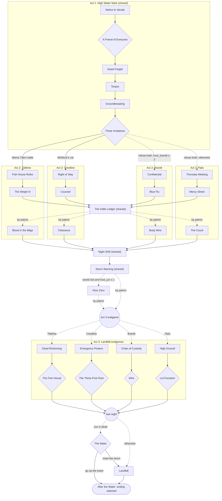

# UNDERTOW: Port Meridian — Ending Design

This document specifies the ending architecture and all twenty endings. Its tables, conditions,
path counts and example paths were produced directly from `data/narrative/ending_registry.json`,
`data/narrative/decision_graph.json` and the validator's witness file
`data/narrative/ending_paths.json`, so they match what the game loads. The data files are the
source of truth; this file is not rebuilt automatically (see section 8). The story, cast and
missions are described in `docs/STORY_BIBLE.md`.

Contents: 1. How an ending is selected · 2. Priority order · 3. State the endings read ·
4. Decision-graph overview · 5. Which decisions feed which endings · 6. Balance ·
7. The twenty endings · 8. Changing this safely

---

## 1. How an ending is selected

The story is a directed acyclic graph of 33 nodes (`decision_graph.json`). Every choice applies a
list of effects to 12 numeric variables and 16 boolean flags, then moves to the next node, which
may itself depend on the state (conditional `next` branches). There is one `finale` node, *After
the Water*. When the player arrives there, `NarrativeState.selectEnding()`:

1. sorts the registry by `priority`, highest first (ties would break on id; there are none);
2. evaluates each ending's `requirements` against the final variables and flags;
3. returns the first ending whose requirements hold;
4. returns the registry `fallback` (`ENDING_20`, whose requirement is `{ "const": true }`) if none do.

Selection is therefore deterministic: the same choices always give the same ending, and an ending
can be explained to a player as "the first true line in the table in section 2."

Two consequences of this design are worth stating plainly:

- **Requirements are written to be read on their own, but they are evaluated in order.** A
  low-priority ending such as *Glass Tower* ("signed with Crestline and stayed in town") is only
  reached when every ending above it has already failed, so its real meaning is "signed with
  Crestline, stayed, and was not arrested, not useful enough to be the fixer, and not rich in a
  nightclub." The plain-language requirement under each ending spells this out.
- **No ending is a dialogue variant.** Each has its own playable final sequence, its own cinematic
  staging (no two share district, time of day, weather and camera) and a different answer to the
  three questions the story asks: what happens to Cass, who is alive, and who runs Port Meridian.

## 2. Priority order

Priorities are grouped in tiers. The rule of thumb is that the more an ending depends on one
specific, irreversible thing, the earlier it is tested.

- **A. Irreversible acts (96–100).** Killing Whitlock, or carrying enough provable crime to be
  convicted. These override whatever else Cass achieved: a kingpin with maximum heat is arrested
  within the month. *The Old Man's Debt* sits above *Ironhook County* because it is the same
  situation with one extra, demanding condition (a living, fully loyal Sal and a clean claim to the yard).
- **B. Earned outcomes (88–94).** The demanding good ending, the throne, the wire, and the price of
  breaking the Tideline oath.
- **C. Faction outcomes (76–86).** Who Cass ended up belonging to.
- **D. What Cass is left holding (68–74).** No faction claims Cass; the ending is decided by what
  they still have: a ledger, a brother, a nightclub or a signature.
- **E. Departures (58–60).** Cass left town. Every ending above requires staying, except *Ghost of
  Odile* (reached from The Wake, before the boat is offered) and *A Name That Isn't Yours* (the
  Marshals relocate Cass whether or not they try to stay), so these two catch everyone else who took the boat.
- **F. Fallback (0).**

| # | Priority | Id | Name | Tier | Exact condition | Share of paths |
| --- | --- | --- | --- | --- | --- | --- |
| 1 | 100 | ENDING_13 | Ghost of Odile | A. Irreversible acts | whitlock_dead AND not jun_alive | 4.00% |
| 2 | 98 | ENDING_19 | The Old Man's Debt | A. Irreversible acts | heat ≥ 4 AND sal_alive AND loyalty_sal ≥ 3 AND owns_yard AND not tideline_made AND not crestline_partner AND not halloran_arrested AND not left_town | 0.79% |
| 3 | 96 | ENDING_04 | Ironhook County | A. Irreversible acts | heat ≥ 4 AND not left_town AND NOT (informant AND halloran_arrested) | 11.21% |
| 4 | 94 | ENDING_02 | Navarro & Navarro | B. Earned outcomes | owns_yard AND jun_alive AND sal_alive AND toby_alive AND whitlock_exposed AND heat ≤ 2 AND not tideline_made AND not crestline_partner AND not left_town | 2.27% |
| 5 | 92 | ENDING_01 | High Tide | B. Earned outcomes | mama_tide_dead AND tideline_made AND notoriety ≥ 3 AND rep_tideline ≥ 1 AND not left_town | 5.91% |
| 6 | 90 | ENDING_03 | A Name That Isn't Yours | B. Earned outcomes | informant AND halloran_arrested | 2.55% |
| 7 | 88 | ENDING_05 | Low Water | B. Earned outcomes | not left_town AND (mama_tide_dead OR (tideline_made AND NOT (allegiance = 1))) | 7.55% |
| 8 | 86 | ENDING_08 | The Flats Stand | C. Faction outcomes | land_trust AND toby_alive AND not left_town | 2.79% |
| 9 | 84 | ENDING_12 | The Odile Papers | C. Faction outcomes | priya_published AND not left_town | 5.09% |
| 10 | 82 | ENDING_16 | The Inheritance | C. Faction outcomes | not toby_alive AND allegiance = 4 AND rep_flats ≥ 1 AND not left_town | 4.37% |
| 11 | 80 | ENDING_11 | Blue Wall | C. Faction outcomes | allegiance = 5 AND rep_mpd ≥ 1 AND not left_town | 0.80% |
| 12 | 78 | ENDING_10 | Right Hand | C. Faction outcomes | tideline_made AND allegiance = 1 AND not mama_tide_dead AND not left_town | 7.76% |
| 13 | 76 | ENDING_07 | Municipal Affairs | C. Faction outcomes | crestline_partner AND rep_crestline ≥ 2 AND notoriety ≥ 2 AND not left_town | 3.30% |
| 14 | 74 | ENDING_18 | The Meridian Accord | D. What Cass is left holding | has_ledger AND not crestline_partner AND not whitlock_exposed AND not left_town | 2.43% |
| 15 | 72 | ENDING_15 | Ashes at Pier 9 | D. What Cass is left holding | not sal_alive AND jun_alive AND not owns_yard AND not crestline_partner AND not left_town | 1.60% |
| 16 | 70 | ENDING_14 | The Lantern Room | D. What Cass is left holding | owns_club AND wealth ≥ 3 AND not left_town | 2.16% |
| 17 | 68 | ENDING_17 | Glass Tower | D. What Cass is left holding | crestline_partner AND not left_town | 1.98% |
| 18 | 60 | ENDING_06 | The Long Reach | E. Departures | left_town AND jun_alive AND trust_jun ≥ 3 | 15.65% |
| 19 | 58 | ENDING_09 | Saltgrass | E. Departures | left_town | 15.18% |
| 20 | 0 | ENDING_20 | Back on the Hook | F. Fallback | always | 2.62% |

## 3. State the endings read

Full definitions and fiction for every variable and flag are in `docs/STORY_BIBLE.md` section 9.
The endings read only these:

| State | Type | Range (start) | Read by |
| --- | --- | --- | --- |
| `wealth` | number | 0 to 3 (0) | 14 |
| `notoriety` | number | 0 to 3 (0) | 01, 07 |
| `heat` | number | 0 to 4 (0) | 02, 04, 19 |
| `rep_tideline` | number | -1 to 2 (0) | 01 |
| `rep_crestline` | number | -1 to 2 (0) | 07 |
| `rep_mpd` | number | -1 to 2 (0) | 11 |
| `rep_flats` | number | -1 to 2 (1) | 16 |
| `trust_jun` | number | 0 to 4 (2) | 06 |
| `loyalty_sal` | number | 0 to 3 (1) | 19 |
| `allegiance` | number | 0 to 5 (0) | 05, 10, 11, 16 |
| `jun_alive` | flag | (true) | 02, 06, 13, 15 |
| `sal_alive` | flag | (true) | 02, 15, 19 |
| `toby_alive` | flag | (true) | 02, 08, 16 |
| `owns_yard` | flag | (false) | 02, 15, 19 |
| `owns_club` | flag | (false) | 14 |
| `has_ledger` | flag | (false) | 18 |
| `informant` | flag | (false) | 03, 04 |
| `tideline_made` | flag | (false) | 01, 02, 05, 10, 19 |
| `crestline_partner` | flag | (false) | 02, 07, 15, 17, 18, 19 |
| `land_trust` | flag | (false) | 08 |
| `whitlock_exposed` | flag | (false) | 02, 18 |
| `whitlock_dead` | flag | (false) | 13 |
| `mama_tide_dead` | flag | (false) | 01, 05, 10 |
| `halloran_arrested` | flag | (false) | 03, 04, 19 |
| `priya_published` | flag | (false) | 12 |
| `left_town` | flag | (false) | 01, 02, 04, 05, 06, 07, 08, 09, 10, 11, 12, 14, 15, 16, 17, 18, 19 |

Not read directly by any ending, but used to gate choices or route the graph: `trust_toby`, `trust_brandt`.

## 4. Decision-graph overview

33 nodes: 25 missions, 7 pure decisions and 1 finale; 86 choices in total.
A playthrough makes 15 to 17 decisions (16 to 18 nodes including the finale). There are 5,035,344 complete
decision paths through 466,849 distinct (node, state) pairs.

Solid arrows are unconditional. Dashed arrows are conditional `next` branches; their label is the
condition. "by patron" means the story returns to whichever faction `allegiance` currently names.
The two circles are not nodes in the data: they stand for the conditional branch lists that every
choice at that point shares (the Act 3 router, and the "is Jun dead?" check before the last night).



Defections (a choice in the third mission of an Act 2 branch changes `allegiance`, so the Act 3
router sends the player to a different endgame): Tideline → Brandt (*Blood in the Bilge*: take
Deck to Brandt), Brandt → Crestline (*Body Wire*: sign the release), Crestline → Flats
(*Clearance*: stand with Toby), Flats → Tideline (*The Count*: borrow from Mama Tide).

### Node table

| Act | Node id | Type | Title | Choices (effects) |
| --- | --- | --- | --- | --- |
| 1 | `a1_notice` | mission (story) | Notice to Vacate | **Cut the chain tonight**: heat +1, loyalty_sal +1<br>**File the fraud complaint downtown**: trust_brandt +1<br>**Call Toby and make it the neighborhood's problem**: rep_flats +1, trust_toby +1 |
| 1 | `a1_nico` | decision | A Friend of Everyone | **Ask for the dock introduction**: rep_tideline +1<br>**Ask for the Crestline courier work**: rep_crestline +1<br>**Take the bond and nothing else**: loyalty_sal +1 |
| 1 | `a1_freight` | mission (delivery) | Dead Freight | **Park it in Bay 3 and take the envelope**: wealth +1, rep_tideline +1<br>**Drop two pallets at the Mercy Street clinic first**: rep_flats +1, trust_toby +1<br>**Photograph every manifest, then deliver**: trust_brandt +1, wealth +1 |
| 1 | `a1_torque` | mission (character) | Torque | **Bring Jun in as your mechanic**: trust_jun +1, notoriety +1<br>**Keep Jun out of it**: trust_jun −1, loyalty_sal +1<br>**Put the winnings into a garage lease in his name** *(requires wealth ≥ 1)*: wealth −1, trust_jun +1 |
| 1 | `a1_ground` | mission (investigation) | Groundbreaking | **Hand the stamp book to Priya**: rep_flats +1, trust_toby +1<br>**Walk it into Detective Brandt's office**: trust_brandt +1<br>**Let Nico sell it back to Crestline**: wealth +1, rep_crestline +1 |
| 1 | `a1_doors` | decision | Three Invitations | **Sit at Mama Tide's table**: allegiance = 1, rep_tideline +1, trust_brandt = 0, rep_crestline = 0<br>**Get into Whitlock's car**: allegiance = 2, rep_crestline +1, trust_brandt = 0, rep_tideline = 0<br>**Turn them both down and fight the lien**: no state change |
| 2 | `a2_tide_1` | mission (delivery) | Fish House Rules | **Deliver every tote, sealed**: rep_tideline +1, notoriety +1<br>**Let one tote go over the side**: wealth +1, rep_tideline −1 |
| 2 | `a2_tide_2` | mission (pursuit) | The Weigh-In | **Cover the difference from your own pocket** *(requires wealth ≥ 1)*: wealth −1, rep_tideline +1, rep_mpd +1<br>**Bring the envelope back and tell her he is squeezing**: rep_tideline +1, heat +1<br>**Record Halloran's price for Detective Brandt**: trust_brandt +1 |
| 2 | `a2_tide_3` | mission (story) | Blood in the Bilge | **Come back alone and take the oath**: tideline_made = true, notoriety +2, rep_tideline +1<br>**Put Deck on a bus, lie to her face, take the oath**: tideline_made = true, loyalty_sal +1<br>**Take Deck straight to Detective Brandt** *(requires trust_brandt ≥ 1)*: informant = true, allegiance = 3, trust_brandt +1, rep_tideline = -1 |
| 2 | `a2_crest_1` | mission (business) | Right of Way | **Tow all forty-one by Friday**: rep_crestline +1, wealth +1, rep_flats −1, trust_toby −1<br>**Tow the abandoned ones and lose the paperwork on the rest**: rep_flats +1, trust_toby +1 |
| 2 | `a2_crest_2` | mission (character) | Counsel | **Tell Whitlock where she keeps her files**: rep_crestline +1, notoriety +1<br>**Keep her secret**: heat −1 |
| 2 | `a2_crest_3` | mission (story) | Clearance | **Serve the order and tow the Collective's vans**: rep_crestline +1, wealth +1, trust_toby = 0, rep_flats = -1<br>**Find a defect in the order and buy Toby a week**: rep_flats +1, trust_toby +1, rep_crestline −1<br>**Park the flatbed across Mercy Street and stand with Toby**: allegiance = 4, rep_flats +1, trust_toby +1, rep_crestline = -1, heat +1 |
| 2 | `a2_badge_1` | mission (investigation) | Confidential | **Do it by the book: photographs only**: allegiance = 3, informant = true, trust_brandt +1, rep_tideline = 0, rep_crestline = 0<br>**Photograph it, then lift the bag off the cruiser**: allegiance = 3, informant = true, wealth +1, heat +1, rep_tideline = 0, rep_crestline = 0 |
| 2 | `a2_badge_2` | mission (pursuit) | Blue Flu | **Deliver Pruitt and sit up all night on watch**: trust_brandt +1<br>**Take Halloran's call on the way**: rep_mpd +1, wealth +1 |
| 2 | `a2_badge_3` | mission (investigation) | Body Wire | **Refuse the money and keep the tape running**: trust_brandt +1<br>**Sign the release and take the money**: wealth +2, allegiance = 2, informant = false, trust_brandt = 0, rep_crestline +1<br>**Play the tape for Halloran before Brandt hears it**: rep_mpd +1, trust_brandt −1 |
| 2 | `a2_flats_1` | mission (delivery) | Thursday Meeting | **Take them quietly at shift change**: allegiance = 4, rep_flats +1, trust_toby +1, rep_crestline = -1<br>**Take them at noon, on camera, with the block watching**: allegiance = 4, rep_flats +1, trust_toby +1, notoriety +1, heat +1, rep_crestline = -1 |
| 2 | `a2_flats_2` | mission (pursuit) | Mercy Street | **Trade her the Flats' silence for the corner**: rep_tideline +1<br>**Leave the car burning on her pier**: rep_tideline = -1, notoriety +1, heat +1<br>**Give the stash and the names to Detective Brandt**: heat −1, rep_tideline −1 |
| 2 | `a2_flats_3` | mission (business) | The Count | **Put every dollar into the trust, anonymously**: rep_flats +1, trust_toby +1, heat +1<br>**Fund half the gap and keep the rest for the lien fight**: wealth +2, heat +1, trust_toby −1<br>**Leave the bags. Borrow it from Mama Tide instead.**: allegiance = 1, rep_tideline +1, trust_toby −1 |
| 2 | `a2_ledger` | mission (investigation) | The Odile Ledger | **Keep it. Tell no one.**: has_ledger = true, heat +1<br>**Trade it to Nico for his stake in the Lantern Room**: owns_club = true, wealth +1<br>**Take only your mother's page and put the rest back**: trust_jun +1 |
| 2 | `a2_jun` | mission (pursuit) | Night Shift | **Make him a full partner. No more secrets.**: trust_jun +1, notoriety +1<br>**Send him to your cousin's in Saltgrass until it is over**: trust_jun −1<br>**Put the councilman's car on your own record**: heat +1, trust_jun +1 |
| 3 | `a3_storm` | mission (story) | Storm Warning | **Go through the fire for Sal**: loyalty_sal +1, trust_jun −1<br>**Leave the yard to burn and get to Jun**: sal_alive = false, loyalty_sal = 0, trust_jun +1<br>**Call Toby and split the job** *(requires trust_toby ≥ 2)*: trust_toby −1, rep_flats −1 |
| 3 | `a3_eastbank` | mission (pursuit) | Hour Zero | **Put the flatbed through the site fence**: heat +2, trust_jun +1<br>**Trade the Odile Ledger for your brother** *(requires has_ledger)*: has_ledger = false, trust_jun +1<br>**Wait for the guards to rotate, the way Sal taught you**: jun_alive = false, trust_jun = 0 |
| 3 | `a3_tide_1` | mission (delivery) | Dead Reckoning | **Moor every container exactly where she said**: rep_tideline +1<br>**Moor one where only you can find it**: wealth +1, notoriety +1 |
| 3 | `a3_tide_2` | decision | The Fish House | **Stand with Mama Tide**: tideline_made = true, allegiance = 1, owns_yard = true<br>**Take the chair**: mama_tide_dead = true, tideline_made = true, allegiance = 1, owns_yard = true, notoriety +1<br>**Sell the moorings to Whitlock**: crestline_partner = true, allegiance = 2, wealth +2, rep_tideline = -1, rep_crestline = 2 |
| 3 | `a3_crest_1` | mission (driving) | Emergency Powers | **Give the order to start the engines**: toby_alive = false, rep_crestline +1, notoriety +1, rep_flats = -1, trust_toby = 0<br>**Jam the lowboy across Mercy Street and blame the weather**: rep_crestline −1 |
| 3 | `a3_crest_2` | decision | The Thirty-First Floor | **Sign. Take the title and the office.**: crestline_partner = true, wealth +2<br>**Back Vivian and burn him from the inside**: whitlock_exposed = true, priya_published = true, owns_yard = true, allegiance = 0, rep_crestline = -1<br>**Tear up the contract and walk out**: allegiance = 0, rep_crestline = -1 |
| 3 | `a3_badge_1` | mission (pursuit) | Chain of Custody | **Deliver all eleven boxes**: trust_brandt +1, heat +1<br>**Lose box seven on the Causeway**: heat −1 |
| 3 | `a3_badge_2` | decision | Wire | **Wear the wire into the union hall**: halloran_arrested = true, whitlock_exposed = true, owns_yard = true, informant = true, allegiance = 3<br>**Give Priya the ledger** *(requires has_ledger)*: priya_published = true, whitlock_exposed = true, has_ledger = false, owns_yard = true<br>**Take Halloran's offer and give him Brandt**: allegiance = 5, informant = false, wealth +2, trust_brandt = 0 |
| 3 | `a3_flats_1` | mission (driving) | High Ground | **Make the last run yourself**: heat +1<br>**Hold the hall doors and let Toby take the skiff**: toby_alive = false, trust_toby = 0<br>**Call in Mama Tide's workboats** *(requires rep_tideline ≥ 1)*: wealth −1 |
| 3 | `a3_flats_2` | decision | Lot Fourteen | **Walk the land-trust bid in with the whole neighborhood behind you**: land_trust = true<br>**Burn the Eastbank site office and every lien record in it**: heat +2, notoriety +1<br>**Give Priya the ledger and let the city read it** *(requires has_ledger)*: priya_published = true, whitlock_exposed = true, has_ledger = false, owns_yard = true |
| 3 | `a3_wake` | decision | The Wake | **Take the coupe and go up the tower**: whitlock_dead = true, heat = 4<br>**Close the bay door and go and meet the storm**: no state change |
| 3 | `a3_landfall` | mission (story) | Landfall | **Take the salvage tug out and pull people off roofs**: heat −1<br>**Use the blackout to settle accounts**: heat +1, notoriety +1<br>**Take the seat on Nico's boat**: left_town = true, allegiance = 0, heat = 0 |
| Finale | `finale` | finale | After the Water | none: the ending is selected here |

## 5. Which decisions feed which endings

Ending numbers are the two digits of the ending id. "Blocks" means the decision can rule an ending out.

| Decision (mission) | What it changes | Endings it feeds |
| --- | --- | --- |
| Notice to Vacate, Dead Freight, Groundbreaking: the three "go to Brandt" options | `trust_brandt`; two of the three open the Brandt branch at Three Invitations | 02, 03, 11, 12, 19 |
| Three Invitations | `allegiance`: which Act 2 branch and, absent a defection, which endgame | Tideline 01, 05, 10 · Crestline 07, 17, 12, 02 · Brandt 02, 03, 11, 12 · Flats 08, 16, 12, 04 |
| Torque, The Odile Ledger (take only the page), Night Shift, Storm Warning | `trust_jun` | Low trust: Hour Zero, then 13 or 09. High trust: 06 instead of 09 when leaving |
| Notice to Vacate (cut the chain), A Friend of Everyone (bond only), Torque (keep Jun out), Blood in the Bilge (spare Deck), Storm Warning (save Sal) | `loyalty_sal` | 19 needs loyalty 3 |
| Fish House Rules, The Weigh-In, Blood in the Bilge (oath), Night Shift (partner), Dead Reckoning (own container), Landfall (blackout) | `notoriety`, `rep_tideline` | 01 if notoriety 3 and Tideline rep 1+, otherwise 05, after taking the chair |
| The Weigh-In (record Halloran) | `trust_brandt` 1 | Unlocks the Tideline → Brandt defection: 03, 02, 11 |
| The Weigh-In (pay), Blue Flu (take the call), Body Wire (play the tape) | `rep_mpd` | 11 needs MPD rep 1+; without it a betrayal of Brandt falls through to 18, 15, 14 or 20 |
| Blood in the Bilge (either oath) | `tideline_made` | 10, 01; 05 for oath-breakers; blocks 02 and 19 |
| Right of Way, Counsel (inform), Clearance (serve), Emergency Powers (demolish) | `rep_crestline`, `notoriety` | 07 if Crestline rep 2 and notoriety 2+, otherwise 17 (or 14) |
| Clearance (stand with Toby) | `allegiance` 4 | 08, 16, 12, 04 |
| Body Wire (sign the release) | `allegiance` 2, informant cleared | 07, 17, 14, 12 |
| The Count (borrow from Mama Tide) | `allegiance` 1 without the oath | 10, 01, 05, and 07 or 17 by selling the moorings safely |
| The Odile Ledger | `has_ledger` or `owns_club` | Ledger: 18, and the "give Priya the ledger" options (12, 02, 19), and the trade in Hour Zero. Club: 14 |
| Every heat source (cut the chain, defy Halloran, keep the ledger, lift the bag, loud generators, burn the car, the payroll job, stand with Toby, take the blame for Jun, ram the fence, all eleven boxes, last run yourself, burn the site office, blackout) | `heat` | 4 = 04, or 19 with a loyal living Sal and a clean claim to the yard (the informant who wore the wire is immune and gets 03). 3+ blocks 02 |
| Storm Warning | `sal_alive`, `trust_jun`, `trust_toby` | Sal dead: 15, blocks 02 and 19. Saving Sal with low Jun trust: Hour Zero |
| Hour Zero | `jun_alive`, `heat` +2, or the ledger | Jun dead: The Wake (13), 09; blocks 02, 06, 15 |
| Emergency Powers (demolish), High Ground (let Toby go) | `toby_alive` | 16 (Flats route only); blocks 02 and 08 |
| The Fish House | `tideline_made` + yard; or `mama_tide_dead`; or `crestline_partner` | Kneel: 10. Chair: 01 or 05. Sell: 05 if sworn, else 07, 17 or 14 |
| The Thirty-First Floor | `crestline_partner`; or exposure + yard; or nothing | Sign: 07, 17, 14. Vivian: 02, 12, 19. Walk: 18, 15, 14, 20 |
| Wire | arrest + exposure + yard; or publication; or `allegiance` 5 | Wire: 02, 03, 19. Ledger to Priya: 02, 12, 19. Halloran: 11, else 18, 15, 14, 20 |
| Lot Fourteen | `land_trust`; or heat +2; or publication | Trust: 08, 16. Burn: 04, 16, 18, 15, 14, 20. Ledger to Priya: 02, 12, 19 |
| The Wake | `whitlock_dead` | 13 |
| Landfall | `heat` ±1; or `left_town` | Leaving: 06 or 09 (03 if Cass wore the wire). Staying: heat decides 04 and 19 and can clear or block 02 |

## 6. Balance

Output of `npm run validate:endings` for the shipped data, counting every complete decision path
(each path weighted equally; this is a coverage measure, not a prediction of player behavior):

```
nodes: 33 (33 reachable)   endings: 20
states explored: 466849   complete paths: 5035344
decisions per playthrough: 15–17

OK   ENDING_01  High Tide                    priority   92  paths   297745 (5.91%)
OK   ENDING_02  Navarro & Navarro            priority   94  paths   114104 (2.27%)
OK   ENDING_03  A Name That Isn't Yours      priority   90  paths   128448 (2.55%)
OK   ENDING_04  Ironhook County              priority   96  paths   564272 (11.21%)
OK   ENDING_05  Low Water                    priority   88  paths   380339 (7.55%)
OK   ENDING_06  The Long Reach               priority   60  paths   787812 (15.65%)
OK   ENDING_07  Municipal Affairs            priority   76  paths   165972 (3.30%)
OK   ENDING_08  The Flats Stand              priority   86  paths   140398 (2.79%)
OK   ENDING_09  Saltgrass                    priority   58  paths   764168 (15.18%)
OK   ENDING_10  Right Hand                   priority   78  paths   390636 (7.76%)
OK   ENDING_11  Blue Wall                    priority   80  paths    40473 (0.80%)
OK   ENDING_12  The Odile Papers             priority   84  paths   256088 (5.09%)
OK   ENDING_13  Ghost of Odile               priority  100  paths   201384 (4.00%)
OK   ENDING_14  The Lantern Room             priority   70  paths   108765 (2.16%)
OK   ENDING_15  Ashes at Pier 9              priority   72  paths    80682 (1.60%)
OK   ENDING_16  The Inheritance              priority   82  paths   220026 (4.37%)
OK   ENDING_17  Glass Tower                  priority   68  paths    99891 (1.98%)
OK   ENDING_18  The Meridian Accord          priority   74  paths   122428 (2.43%)
OK   ENDING_19  The Old Man's Debt           priority   98  paths    40000 (0.79%)
OK   ENDING_20  Back on the Hook             priority    0  paths   131713 (2.62%)
```

Every ending is reachable. The rarest ending holds 0.79% of paths and the most common 15.65%.
The two departure endings are the largest because "take the boat" is offered at the end of almost
every route; the rarest are the two that need a specific earlier investment (Halloran's money for
*Blue Wall*, Sal's full loyalty plus maximum heat for *The Old Man's Debt*).

## 7. The twenty endings

### ENDING_01 — High Tide

**Cass's fate:** Kingpin of the Tideline  
**Tone:** Triumphant and cold  
**Priority:** 92 (tested 5 of 20)  
**Share of decision paths:** 5.91%

**Requirements, in plain language.** Cass ordered the death of Mama Tide, has taken the Tideline oath, is notorious enough (notoriety 3) and respected enough on the docks (Tideline rep 1+) for her captains to follow, and stayed in Port Meridian. (Heat must be below 4, or the arrest endings fire first.)

**Exact condition.** `mama_tide_dead AND tideline_made AND notoriety ≥ 3 AND rep_tideline ≥ 1 AND not left_town`

```json
{"all":[{"flag":"mama_tide_dead","is":true},{"flag":"tideline_made","is":true},{"var":"notoriety","gte":3},{"var":"rep_tideline","gte":1},{"flag":"left_town","is":false}]}
```

**Summary.** Odalys Ferrer is buried at sea in the calm after Pilar, and by the time the water goes down the Tideline has a new voice in the fish house. Cass Navarro holds Pier 9, the Sol Strand moorings and every dock crew from Ironhook to Pelican Marina. Crestline's harborfront permits go into a line that never moves, and the Harbor Unit's envelope goes back to the old amount. Navarro Salvage is open again and busier than it ever was under Inés. Nothing that comes through the gate is salvage.

**Consequences for the city**

- The Tideline survives Hurricane Pilar intact and under younger management; the federal port audit finds a well-run fish house.
- Crestline's harborfront phase is frozen indefinitely. Eastbank goes ahead without a waterfront.
- Relief supplies reach the Flats on time for the first time in three years, at a price, from the same organization that used to steal them.
- Navarro Salvage reopens on Pier 9 as the front office of the syndicate.

**Character outcomes**

- **Cass Navarro** (`cass`): Boss of the Tideline. Runs the port from Inés's old desk, which has been carried into the fish house. Does not sit with their back to the door.
- **Odalys "Mama Tide" Ferrer** (`mama_tide`): Dead. Given the trawlerman's burial she asked for years ago, by the people who killed her.
- **Graham Whitlock** (`whitlock`): Alive, rich and stalled. Pays the new "port facilitation fee" and describes it to his board as a logistics cost.
- **Captain Royce Halloran** (`halloran`): Takes the old envelope from the new boss and calls it stability. Has started being careful what he says near open windows.
- **Detective Lena Brandt** (`brandt`): Opens a fresh folder with a familiar surname on the tab and a much longer time horizon.
- **Nico Valdés** (`nico`): Comes back in the spring with a bottle and a proposal. Is told to wait in line, which delights him.
- **Jun Navarro** (`jun`): Whatever is left between the Navarros is conducted in short sentences. If Jun is alive he keeps his garage and sends the envelopes back unopened.

**Final sequence** (`seq_burial_at_sea`). Burial at Sea. Cass pilots the trawler Tres Marías out past Sol Strand through storm debris with Mama Tide's casket and her six captains aboard. One at a time, in a walk-and-talk along the deck, each captain hands over a mooring key or has to be persuaded. The player then runs the trawler home and drives the length of the pier road as the dock crews switch their work lights on, one berth at a time, for the new boss.

**Cinematic.** Ironhook Port (`port`), 05:30, weather `fog`, camera `crane`, 6 shots, 35 seconds.  
*Music:* Low brass and slow hand drums: a funeral march that resolves, without changing tempo, into a coronation.

1. (6s) Gray water before dawn. The trawler Tres Marías sits dead in the swell off Sol Strand; six people in oilskins stand at the rail around a plain casket.
2. (5s) Close on a ring of brass mooring keys passing from one weathered hand into Cass's. Nobody speaks.
3. (6s) The casket goes over. The crane shot rises with the splash until the trawler is a small shape on a very large Gulf.
4. (7s) Ironhook Port in fog. As the flatbed rolls down the pier road, work lights come on berth by berth ahead of it, like a runway.
5. (6s) Inside Ferrer's Fish House. Inés's scarred salvage desk sits where the old woman's table was. Cass lowers into the chair behind it, facing the door.
6. (5s) The camera cranes up through the roof beams and out over the pier: the gate of Navarro Salvage stands open, and a container is already coming through it.

**Example decision path** (the validator's witness for this ending, 15 decisions):

1. *Notice to Vacate* → Cut the chain tonight (`a1_notice_cut`)
2. *A Friend of Everyone* → Ask for the dock introduction (`a1_nico_docks`)
3. *Dead Freight* → Park it in Bay 3 and take the envelope (`a1_freight_deliver`)
4. *Torque* → Bring Jun in as your mechanic (`a1_torque_in`)
5. *Groundbreaking* → Hand the stamp book to Priya (`a1_ground_priya`)
6. *Three Invitations* → Sit at Mama Tide's table (`a1_doors_tide`)
7. *Fish House Rules* → Deliver every tote, sealed (`a2_tide_1_clean`)
8. *The Weigh-In* → Cover the difference from your own pocket (`a2_tide_2_pay`)
9. *The Odile Ledger* → Keep it. Tell no one. (`a2_ledger_keep`)
10. *Blood in the Bilge* → Come back alone and take the oath (`a2_tide_3_oath`)
11. *Night Shift* → Make him a full partner. No more secrets. (`a2_jun_partner`)
12. *Storm Warning* → Go through the fire for Sal (`a3_storm_sal`)
13. *Dead Reckoning* → Moor every container exactly where she said (`a3_tide_1_moor`)
14. *The Fish House* → Take the chair (`a3_tide_2_coup`)
15. *Landfall* → Take the salvage tug out and pull people off roofs (`a3_landfall_water`)

### ENDING_02 — Navarro & Navarro

**Cass's fate:** Legitimate owner, family intact  
**Tone:** Hard-won and warm  
**Priority:** 94 (tested 4 of 20)  
**Share of decision paths:** 2.27%

**Requirements, in plain language.** Cass holds the yard again, Jun, Sal and Toby are all alive, the lien fraud has been proven in public, heat is 2 or less, and Cass never took the Tideline oath, never signed with Crestline and did not leave town.

**Exact condition.** `owns_yard AND jun_alive AND sal_alive AND toby_alive AND whitlock_exposed AND heat ≤ 2 AND not tideline_made AND not crestline_partner AND not left_town`

```json
{"all":[{"flag":"owns_yard","is":true},{"flag":"jun_alive","is":true},{"flag":"sal_alive","is":true},{"flag":"toby_alive","is":true},{"flag":"whitlock_exposed","is":true},{"var":"heat","lte":2},{"flag":"tideline_made","is":false},{"flag":"crestline_partner","is":false},{"flag":"left_town","is":false}]}
```

**Summary.** The lien is vacated in open court and the chain comes off the gate with a county deputy holding the bolt cutters. Graham Whitlock is indicted on two hundred and six counts of forgery and fraud, and the Rebuild Authority goes into receivership. Cass kept their hands just clean enough: no oath, no contract, nothing a prosecutor wants more than Whitlock. Navarro Salvage reopens with Jun's name beside Cass's on the sign and Old Sal complaining about the new coffee machine. It is a small yard on an industrial pier. It is theirs.

**Consequences for the city**

- All 206 forged remediation liens are voided and the Rebuild Authority is placed in receivership under a court-appointed monitor.
- Crestline Development Group is broken up; Eastbank Phase Two stops at the foundations.
- The Harbor Unit is put under state review after the union payoffs are entered into evidence.
- Navarro Salvage becomes the test case every other lien victim in Port Meridian cites.

**Character outcomes**

- **Cass Navarro** (`cass`): Owner-operator of Navarro Salvage, on paper and in fact. Still drives the flatbed. Still checks the gate twice at night.
- **Jun Navarro** (`jun`): Full partner. Runs the engine shop out of the north shed and has stopped apologizing to cars.
- **Salvatore "Old Sal" Dupree** (`sal`): Semi-retired to a chair by the gate with Inés's logbooks. Semi-retired means he arrives at six instead of five.
- **Tobias "Toby" Akana** (`toby`): Alive, exhausted and the yard's first customer of the new era: the Collective's van will not start. The tow is on the house.
- **Graham Whitlock** (`whitlock`): Indicted. Awaiting trial in Crown Shore with an ankle monitor and a much smaller legal team.
- **Priya Raman** (`priya`): Her series on the Rebuild runs for eleven Sundays. She frames the stamp book.
- **Detective Lena Brandt** (`brandt`): Finally gets a case number, a budget and a prosecutor who returns her calls.

**Final sequence** (`seq_open_gate`). Open Gate. A bright morning drive with Jun from the courthouse annex in Meridian Center to Pier 9, court order on the dashboard. The deputy cuts the chain; the player uses the flatbed winch to haul the NAVARRO SALVAGE sign back up onto its posts while Sal directs from his chair. The final playable beat is the most ordinary job in the game: a call comes in, Toby's van has died on Mercy Street, and Cass and Jun drive out to tow it.

**Cinematic.** Ironhook Port (`port`), 08:00, weather `clear`, camera `dolly`, 6 shots, 35 seconds.  
*Music:* Acoustic guitar and a brushed snare, unhurried, in a major key that took all game to earn.

1. (5s) Bolt cutters close on a sheriff's chain. It drops off the gate of Navarro Salvage into a puddle left by the storm.
2. (6s) The camera dollies back as the gate swings open: Cass on one side, Jun on the other, pushing.
3. (6s) The winch whines. A hand-painted sign rises against a clean blue sky: NAVARRO & NAVARRO, MARINE SALVAGE. The second name is still wet.
4. (5s) Old Sal in a plastic chair by the gate, logbook open on his knee, pointing at something they are both doing wrong.
5. (6s) The yard phone rings. Jun answers, listens, grins, and throws Cass the keys to the flatbed.
6. (7s) The flatbed pulls out past the open gate and down the pier road, small against the cranes, with both Navarros in the cab.

**Example decision path** (the validator's witness for this ending, 15 decisions):

1. *Notice to Vacate* → Cut the chain tonight (`a1_notice_cut`)
2. *A Friend of Everyone* → Ask for the dock introduction (`a1_nico_docks`)
3. *Dead Freight* → Park it in Bay 3 and take the envelope (`a1_freight_deliver`)
4. *Torque* → Bring Jun in as your mechanic (`a1_torque_in`)
5. *Groundbreaking* → Hand the stamp book to Priya (`a1_ground_priya`)
6. *Three Invitations* → Sit at Mama Tide's table (`a1_doors_tide`)
7. *Fish House Rules* → Deliver every tote, sealed (`a2_tide_1_clean`)
8. *The Weigh-In* → Record Halloran's price for Detective Brandt (`a2_tide_2_tape`)
9. *The Odile Ledger* → Keep it. Tell no one. (`a2_ledger_keep`)
10. *Blood in the Bilge* → Take Deck straight to Detective Brandt (`a2_tide_3_turn`)
11. *Night Shift* → Make him a full partner. No more secrets. (`a2_jun_partner`)
12. *Storm Warning* → Go through the fire for Sal (`a3_storm_sal`)
13. *Chain of Custody* → Deliver all eleven boxes (`a3_badge_1_all`)
14. *Wire* → Wear the wire into the union hall (`a3_badge_2_wire`)
15. *Landfall* → Take the salvage tug out and pull people off roofs (`a3_landfall_water`)

### ENDING_03 — A Name That Isn't Yours

**Cass's fate:** Informant in witness protection  
**Tone:** Bittersweet and quiet  
**Priority:** 90 (tested 6 of 20)  
**Share of decision paths:** 2.55%

**Requirements, in plain language.** Cass is Brandt's informant and wore the wire that put Captain Halloran in handcuffs, but did not qualify for the full legitimate ending (somebody is dead, or heat is 3 or more). The cooperation deal covers Cass's own crimes; the price is that, whether Cass tries to stay or leaves on Nico's boat, the Marshals relocate them.

**Exact condition.** `informant AND halloran_arrested`

```json
{"all":[{"flag":"informant","is":true},{"flag":"halloran_arrested","is":true}]}
```

**Summary.** The wire holds up. Royce Halloran is taken in the Benevolent Hall parking lot and Graham Whitlock two days later at the private terminal. The testimony that does it has a face, and every dock crew and patrol car in Port Meridian knows whose. The U.S. Marshals do not offer a choice so much as a departure time. Cass Navarro stops existing on a Tuesday, and somebody with a different name starts work at a boatyard on a cold lake fifteen hundred miles from salt water.

**Consequences for the city**

- The Harbor Unit is disbanded and the Patrolmen's Benevolent Hall is searched by state police for three days.
- The Navarro lien is vacated in open court. Pier 9 goes back to the Navarro estate, and the person who won it will never stand on it again.
- The Tideline loses its arrangement with the police and half its routes inside a season.
- Crestline enters receivership; the Rebuild Authority's books are opened to federal auditors.

**Character outcomes**

- **Cass Navarro** (`cass`): Relocated under a new identity. Fixes outboards on a freshwater lake and flinches at unmarked sedans. Alive, free and nobody.
- **Detective Lena Brandt** (`brandt`): Reinstated and put in charge of the joint state task force. Writes Cass a letter she is not permitted to send, and keeps it in her desk.
- **Captain Royce Halloran** (`halloran`): Arrested on the recording. Pleads to racketeering and takes fourteen years in federal custody.
- **Graham Whitlock** (`whitlock`): Indicted on the strength of one sentence spoken by a police captain into a tow driver's collar.
- **Odalys "Mama Tide" Ferrer** (`mama_tide`): Loses her police protection overnight. Puts a price on a name that no longer belongs to anyone.
- **Jun Navarro** (`jun`): If Jun is alive, the Marshals' paperwork has a second line on it. Whether it gets filled in is the last decision the Navarros make together.

**Final sequence** (`seq_no_forwarding`). No Forwarding Address. A night drive in a Marshals' unmarked SUV, radio off, from the state field office in Saltgrass north along the I-9. The deputy in the passenger seat allows one detour, and the player chooses which: past the yard, past Jun's garage or down Mercy Street. Cass may slow down but not stop or get out. The sequence ends at a rest area, handing a phone, a wallet and a set of flatbed keys through a window.

**Cinematic.** Saltgrass County (`saltgrass`), 04:00, weather `cloudy`, camera `static`, 5 shots, 30 seconds.  
*Music:* Solo piano, sparse, with long rests where the melody ought to be.

1. (6s) A locked-off frame of an empty county rest area at four in the morning. One sodium light. One gray SUV, engine running.
2. (5s) A hand passes a phone, a wallet and a ring of keys with a tow-hook fob through the window into a clear evidence bag.
3. (6s) Close on a new driver's license under the dome light. The photograph is Cass. The name is not.
4. (6s) Static wide: the SUV pulls out and its tail lights shrink down a dead-straight road through the saltgrass until the dark closes over them.
5. (7s) Cut to daylight, somewhere cold. A boatyard on a flat gray lake. A figure in an unfamiliar jacket lowers an outboard into a test tank and does not look up.

**Example decision path** (the validator's witness for this ending, 15 decisions):

1. *Notice to Vacate* → Cut the chain tonight (`a1_notice_cut`)
2. *A Friend of Everyone* → Ask for the dock introduction (`a1_nico_docks`)
3. *Dead Freight* → Park it in Bay 3 and take the envelope (`a1_freight_deliver`)
4. *Torque* → Bring Jun in as your mechanic (`a1_torque_in`)
5. *Groundbreaking* → Hand the stamp book to Priya (`a1_ground_priya`)
6. *Three Invitations* → Sit at Mama Tide's table (`a1_doors_tide`)
7. *Fish House Rules* → Deliver every tote, sealed (`a2_tide_1_clean`)
8. *The Weigh-In* → Record Halloran's price for Detective Brandt (`a2_tide_2_tape`)
9. *The Odile Ledger* → Keep it. Tell no one. (`a2_ledger_keep`)
10. *Blood in the Bilge* → Take Deck straight to Detective Brandt (`a2_tide_3_turn`)
11. *Night Shift* → Make him a full partner. No more secrets. (`a2_jun_partner`)
12. *Storm Warning* → Go through the fire for Sal (`a3_storm_sal`)
13. *Chain of Custody* → Deliver all eleven boxes (`a3_badge_1_all`)
14. *Wire* → Wear the wire into the union hall (`a3_badge_2_wire`)
15. *Landfall* → Use the blackout to settle accounts (`a3_landfall_dark`)

### ENDING_04 — Ironhook County

**Cass's fate:** Prison  
**Tone:** Sober and unsentimental  
**Priority:** 96 (tested 3 of 20)  
**Share of decision paths:** 11.21%

**Requirements, in plain language.** Cass stayed in Port Meridian with heat at 4 (the maximum): enough provable crime to convict, nobody willing or able to take the fall, and no cooperation deal (the informant who wore the wire on Halloran has immunity and is relocated instead).

**Exact condition.** `heat ≥ 4 AND not left_town AND NOT (informant AND halloran_arrested)`

```json
{"all":[{"var":"heat","gte":4},{"flag":"left_town","is":false},{"not":{"all":[{"flag":"informant","is":true},{"flag":"halloran_arrested","is":true}]}}]}
```

**Summary.** Whatever else Cass Navarro won or lost, the file got thick. Burglary, grand theft, assault on officers, a hurricane's worth of things done in the dark: the state does not need a conspiracy when it has a dozen small crimes on camera. Cass is arrested at a roadblock on the pier road the week the water goes down, and takes fourteen years at Ironhook County Correctional rather than name anyone. From the yard-side cells you can see the cranes on Pier 9. Somebody else is working them.

**Consequences for the city**

- The first conviction to come out of the Pilar emergency is a tow-truck driver's.
- Every faction that used Cass denies ever having met them; none of them is asked twice.
- Navarro Salvage's fate is decided by other people: a patron, a trustee or an auctioneer, depending on who was holding the deed when the handcuffs went on.
- On the docks, "doing a Navarro" comes to mean doing the time and keeping your mouth shut.

**Character outcomes**

- **Cass Navarro** (`cass`): Inmate at Ironhook County Correctional, fourteen years, parole hearing in nine. Runs the prison motor pool better than it has ever been run.
- **Priya Raman** (`priya`): Covers the sentencing. Writes the only piece that asks why the tow driver got more time than anyone with an office.
- **Nico Valdés** (`nico`): Puts money on the commissary account every month under the name "A. Friend".
- **Detective Lena Brandt** (`brandt`): Whether or not she still carries a badge, she writes to the parole board every year. The letters get longer.
- **Jun Navarro** (`jun`): If he is alive, he is in the visiting room on the first Sunday of every month, talking about carburetors because neither of them can talk about anything else.

**Final sequence** (`seq_roadblock`). Roadblock. One last drive in the flatbed along the pier road at dusk, in rain, with a five-star response that cannot be escaped: the Causeway barriers are down, the I-9 ramps are blocked with sanitation trucks and the harbor patrol is in the channel. The player can run until the road ends or stop and put both hands on the wheel. Either way the sequence ends with a slow, controllable walk through intake at Ironhook County.

**Cinematic.** Ironhook Port (`port`), 17:30, weather `rain`, camera `chase`, 5 shots, 30 seconds.  
*Music:* Low sustained strings under a single distorted guitar note that never resolves.

1. (5s) Chase camera tight behind the flatbed on the pier road, wipers losing to the rain, blue light filling both mirrors.
2. (5s) Ahead: two sanitation trucks nose to nose across the road and a line of rifles behind them. The brake lights come on.
3. (6s) Through the windshield: Cass's hands, placed at ten and two on the wheel, perfectly still.
4. (6s) An intake corridor. A property tray: bootlaces, a belt, a tow-hook key fob. A steel door slides shut on the sound of the rain.
5. (8s) A narrow cell window at dusk. Beyond the wire, across the water, the cranes of Pier 9 are moving. The camera holds until the light goes.

**Example decision path** (the validator's witness for this ending, 15 decisions):

1. *Notice to Vacate* → Cut the chain tonight (`a1_notice_cut`)
2. *A Friend of Everyone* → Ask for the dock introduction (`a1_nico_docks`)
3. *Dead Freight* → Park it in Bay 3 and take the envelope (`a1_freight_deliver`)
4. *Torque* → Bring Jun in as your mechanic (`a1_torque_in`)
5. *Groundbreaking* → Hand the stamp book to Priya (`a1_ground_priya`)
6. *Three Invitations* → Sit at Mama Tide's table (`a1_doors_tide`)
7. *Fish House Rules* → Deliver every tote, sealed (`a2_tide_1_clean`)
8. *The Weigh-In* → Cover the difference from your own pocket (`a2_tide_2_pay`)
9. *The Odile Ledger* → Keep it. Tell no one. (`a2_ledger_keep`)
10. *Blood in the Bilge* → Come back alone and take the oath (`a2_tide_3_oath`)
11. *Night Shift* → Put the councilman's car on your own record (`a2_jun_blame`)
12. *Storm Warning* → Go through the fire for Sal (`a3_storm_sal`)
13. *Dead Reckoning* → Moor every container exactly where she said (`a3_tide_1_moor`)
14. *The Fish House* → Stand with Mama Tide (`a3_tide_2_kneel`)
15. *Landfall* → Use the blackout to settle accounts (`a3_landfall_dark`)

### ENDING_05 — Low Water

**Cass's fate:** Death  
**Tone:** Tragic and abrupt  
**Priority:** 88 (tested 7 of 20)  
**Share of decision paths:** 7.55%

**Requirements, in plain language.** Cass stayed in town after crossing the Tideline in a way it cannot forgive: either Mama Tide is dead and Cass lacked the standing to hold her chair, or Cass took the oath and then stopped working for the Tideline (sold the moorings to Whitlock).

**Exact condition.** `not left_town AND (mama_tide_dead OR (tideline_made AND NOT (allegiance = 1)))`

```json
{"all":[{"flag":"left_town","is":false},{"any":[{"flag":"mama_tide_dead","is":true},{"all":[{"flag":"tideline_made","is":true},{"not":{"var":"allegiance","eq":1}}]}]}]}
```

**Summary.** The Tideline oath has no exit clause. Cass either reached for Odalys Ferrer's chair without the standing to keep it, or knelt in her fish house and then sold her moorings to Crestline, and the port settles both accounts the same way. Three days after Pilar, at the lowest tide of the month, the flatbed is found idling at the end of Pier 2 with the driver's door open. The harbor gives Cass Navarro back a week later, off the old Navarro moorings, where only a Navarro would have known to look.

**Consequences for the city**

- The Tideline closes ranks. Nobody outside the fish house is ever certain who gave the order, and nobody inside it says.
- Pier 9 goes to whoever moves fastest. Within a year there is no Navarro name on the gate, and nobody left with the standing to object.
- Dock crews paint a small tow hook on a piling at the end of Pier 2. Nobody admits to it and nobody paints over it.

**Character outcomes**

- **Cass Navarro** (`cass`): Dead at the lowest tide of the month. Recovered off the Sol Strand moorings and buried beside Inés in the mariners' cemetery in Saltgrass.
- **Odalys "Mama Tide" Ferrer** (`mama_tide`): Alive or dead, it is done in her name. The fish house closes for one day and reopens without comment.
- **Graham Whitlock** (`whitlock`): Sends flowers through an assistant. Finds the people on the docks no easier to deal with than before.
- **Nico Valdés** (`nico`): Pays for the funeral from wherever he is. Does not attend. Has the bill sent to an address that does not exist.
- **Priya Raman** (`priya`): Files eleven paragraphs under the headline "Salvage Operator Drowned in Storm Aftermath". Her editor cuts the twelfth.
- **Jun Navarro** (`jun`): If Jun is alive, he identifies the body, sells the coupe and leaves the Gulf coast before anyone can ask him to pick a side.

**Final sequence** (`seq_low_tide`). Low Tide at Pier 2. A message says the fish house wants to "talk terms". The player drives the flatbed to Pier 2 at first light and walks the length of the pier with only walking speed under their control, while dock hands step out of doorways behind them one by one. A last conversation offers three things Cass could say; none of them changes anything. The screen cuts to black on the sound of the flatbed still idling.

**Cinematic.** Ironhook Port (`port`), 06:30, weather `cloudy`, camera `orbit`, 5 shots, 30 seconds.  
*Music:* A single held cello note, then nothing but harbor sound: halyards, gulls, an engine ticking over.

1. (6s) A slow orbit around the Navarro flatbed at the end of Pier 2, engine idling, driver's door open, headlights pale in the daylight.
2. (5s) Low tide. Pilings stand exposed down to the barnacles; the mud flats run out to a flat gray horizon.
3. (6s) A dock hand reaches into the cab, turns the key and takes it out. The engine stops. He puts the key on the dashboard and walks away.
4. (6s) Days later: a harbor patrol launch stopped over the old Navarro moorings off Sol Strand. Two officers looking down into the water. One takes off his cap.
5. (7s) The orbit completes on a tarred piling at Pier 2 where someone has painted, small and white, a tow hook.

**Example decision path** (the validator's witness for this ending, 15 decisions):

1. *Notice to Vacate* → Cut the chain tonight (`a1_notice_cut`)
2. *A Friend of Everyone* → Ask for the dock introduction (`a1_nico_docks`)
3. *Dead Freight* → Park it in Bay 3 and take the envelope (`a1_freight_deliver`)
4. *Torque* → Bring Jun in as your mechanic (`a1_torque_in`)
5. *Groundbreaking* → Hand the stamp book to Priya (`a1_ground_priya`)
6. *Three Invitations* → Sit at Mama Tide's table (`a1_doors_tide`)
7. *Fish House Rules* → Deliver every tote, sealed (`a2_tide_1_clean`)
8. *The Weigh-In* → Cover the difference from your own pocket (`a2_tide_2_pay`)
9. *The Odile Ledger* → Keep it. Tell no one. (`a2_ledger_keep`)
10. *Blood in the Bilge* → Come back alone and take the oath (`a2_tide_3_oath`)
11. *Night Shift* → Make him a full partner. No more secrets. (`a2_jun_partner`)
12. *Storm Warning* → Go through the fire for Sal (`a3_storm_sal`)
13. *Dead Reckoning* → Moor every container exactly where she said (`a3_tide_1_moor`)
14. *The Fish House* → Sell the moorings to Whitlock (`a3_tide_2_sell`)
15. *Landfall* → Take the salvage tug out and pull people off roofs (`a3_landfall_water`)

### ENDING_06 — The Long Reach

**Cass's fate:** Exile by boat with Jun  
**Tone:** Wistful and open-ended  
**Priority:** 60 (tested 18 of 20)  
**Share of decision paths:** 15.65%

**Requirements, in plain language.** Cass took the seat on Nico's boat, and Jun is alive and trusts Cass enough (trust 3+) to come too. Nothing higher in the list applied (in practice: Cass was not the wired informant).

**Exact condition.** `left_town AND jun_alive AND trust_jun ≥ 3`

```json
{"all":[{"flag":"left_town","is":true},{"flag":"jun_alive","is":true},{"var":"trust_jun","gte":3}]}
```

**Summary.** The last boat out of Pelican Marina has two Navarros on it. They take nothing from Port Meridian but a toolbox, Inés's logbooks and each other, and they do not look back until the city is a smear of orange under the storm. By spring there is a small salvage and repair outfit working out of a river port a long way down the coast, cash only, under a hand-painted sign that says NAVARRO and nothing else. Nobody there has heard of Crestline. Cass still checks the mirrors.

**Consequences for the city**

- Every faction in Port Meridian adjusts to a city with no Navarro in it, and each of them tells the story as though it won.
- Whatever oath, contract or case Cass left unfinished is finished, or buried, by other people.
- Pier 9 stays with whoever was strongest on the night of the storm.
- A river port down the coast acquires the best salvage crew it has ever had and no idea why they flinch at gray sedans.

**Character outcomes**

- **Cass Navarro** (`cass`): Gone, by choice and by water. Runs a two-person salvage outfit on a brown river under no name the Rebuild Authority has on file.
- **Jun Navarro** (`jun`): On the boat. Rebuilds the outfit's first engine from a wreck they raise in their second week, and paints the sign himself.
- **Nico Valdés** (`nico`): Puts them ashore, shakes both hands and keeps going south. Sends work every few months and never once asks for a percentage.
- **Salvatore "Old Sal" Dupree** (`sal`): If the old man lived, he refuses to leave Pier 9 on principle and mails a photograph of the gate every month, so that they have to keep an address.
- **Priya Raman** (`priya`): Leaves a voicemail twice a year asking for one sentence on the record. Has stopped expecting a call back.

**Final sequence** (`seq_long_reach`). The Long Reach. Cass takes the wheel of Nico's forty-foot sport-fisher and runs the Pelican Marina channel in full storm surge, with Jun on the bow calling out debris, loose moorings and a drifting yacht called Second Act. The harbor patrol's last sweep has to be outrun without lights. Once past the breakwater the sea opens out, the controls go quiet and the player simply holds a heading south until first light.

**Cinematic.** Pelican Marina (`marina`), 05:00, weather `storm`, camera `flyover`, 6 shots, 33 seconds.  
*Music:* Slide guitar over a slow two-chord vamp, with room in it.

1. (5s) Flyover of Pelican Marina in the storm: masts whipping, pontoons breaking loose, one boat with its running lights off pushing for the channel.
2. (5s) On deck, soaked: Jun at the bow pointing, shouting something the wind takes. Cass at the wheel, reading his hands instead.
3. (6s) The boat clears the breakwater. Behind it the city goes dark district by district, until only the orange glow of Ironhook is left.
4. (6s) The camera climbs away from the boat through the cloud deck and into the first gray of morning over open water.
5. (7s) Months later, from the air: a brown river, a tin-roofed shed on pilings, a hand-painted sign. Two figures are winching something out of the mud.
6. (4s) Close on the sign: NAVARRO. Nothing else.

**Example decision path** (the validator's witness for this ending, 15 decisions):

1. *Notice to Vacate* → Cut the chain tonight (`a1_notice_cut`)
2. *A Friend of Everyone* → Ask for the dock introduction (`a1_nico_docks`)
3. *Dead Freight* → Park it in Bay 3 and take the envelope (`a1_freight_deliver`)
4. *Torque* → Bring Jun in as your mechanic (`a1_torque_in`)
5. *Groundbreaking* → Hand the stamp book to Priya (`a1_ground_priya`)
6. *Three Invitations* → Sit at Mama Tide's table (`a1_doors_tide`)
7. *Fish House Rules* → Deliver every tote, sealed (`a2_tide_1_clean`)
8. *The Weigh-In* → Cover the difference from your own pocket (`a2_tide_2_pay`)
9. *The Odile Ledger* → Keep it. Tell no one. (`a2_ledger_keep`)
10. *Blood in the Bilge* → Come back alone and take the oath (`a2_tide_3_oath`)
11. *Night Shift* → Make him a full partner. No more secrets. (`a2_jun_partner`)
12. *Storm Warning* → Go through the fire for Sal (`a3_storm_sal`)
13. *Dead Reckoning* → Moor every container exactly where she said (`a3_tide_1_moor`)
14. *The Fish House* → Stand with Mama Tide (`a3_tide_2_kneel`)
15. *Landfall* → Take the seat on Nico's boat (`a3_landfall_leave`)

### ENDING_07 — Municipal Affairs

**Cass's fate:** The Mayor's and Crestline's fixer  
**Tone:** Sardonic, corrupt and comfortable  
**Priority:** 76 (tested 13 of 20)  
**Share of decision paths:** 3.30%

**Requirements, in plain language.** Cass signed with Whitlock (or sold him the Tideline moorings without ever having taken the oath), is on Crestline's org chart (Crestline rep 2), carries enough reputation to be worth employing (notoriety 2+), and stayed in town.

**Exact condition.** `crestline_partner AND rep_crestline ≥ 2 AND notoriety ≥ 2 AND not left_town`

```json
{"all":[{"flag":"crestline_partner","is":true},{"var":"rep_crestline","gte":2},{"var":"notoriety","gte":2},{"flag":"left_town","is":false}]}
```

**Summary.** Pier 9 becomes Phase Three: a marina village with a salvage-themed food hall. Cass Navarro becomes Deputy Director for Municipal Affairs, which is the title City Hall gives the person who makes Crestline's problems stop being problems. Permits arrive, inspectors lose interest, holdouts discover reasons to sell. Cass is very good at it, because every trick in the job was once used on the Navarros. Graham Whitlock announces his run for mayor in the spring and thanks his deputy by name.

**Consequences for the city**

- Eastbank Phase Two and the Pier 9 marina village are completed on schedule and under budget, which is how you can tell.
- Mercy Street is rezoned "transitional mixed-use". The Flats frontage is next on the Phase Four map.
- The remediation-lien ordinance is offered to other storm-hit cities as model legislation, with Cass as the traveling expert.
- Whitlock's campaign makes the Rebuild its platform and the Navarro settlement its proof that "the process works".

**Character outcomes**

- **Cass Navarro** (`cass`): Deputy Director for Municipal Affairs. A city car, a corner office and a calendar full of other people's problems. Sleeps fine, mostly.
- **Graham Whitlock** (`whitlock`): Declares for mayor on the steps of the Eastbank sales center, running on "finishing the Rebuild". Polls well.
- **Captain Royce Halloran** (`halloran`): Finds himself taking instructions from a former tow driver with an office at City Hall, and adjusts with professional grace.
- **Vivian Cho** (`vivian`): Still general counsel. Updates her private files weekly and has opened a new one with a Navarro on the tab.
- **Odalys "Mama Tide" Ferrer** (`mama_tide`): Loses the harborfront to Phase Three one permit at a time, and keeps a list of who signed them.
- **Jun Navarro** (`jun`): If he is alive, he has a standing offer of the city fleet-maintenance contract and has never replied to it.

**Final sequence** (`seq_ribbon_cutting`). Ribbon Cutting. Cass drives a city SUV with Whitlock in the back seat across three stops before a noon ceremony: persuading a building inspector to sign in a parking lot (a conversation with only wrong answers), towing a protester's car that is blocking the stage (the last tow in the game, performed in a suit) and delivering the candidate to the podium on time. The podium stands where the Navarro yard office used to be.

**Cinematic.** Eastbank Rebuild Zone (`eastbank`), 11:00, weather `clear`, camera `flyover`, 6 shots, 33 seconds.  
*Music:* Bright corporate strings and a hand-clap beat, mixed slightly too loud.

1. (5s) A glossy flyover of the Eastbank Rebuild Zone: tower cranes, show homes, banners reading PORT MERIDIAN: BUILT BACK.
2. (5s) A podium, a ribbon, gold-plated scissors. Graham Whitlock at the microphone, one hand extended to someone just off stage.
3. (6s) Cass steps up beside him in a good suit. The applause is polite and well rehearsed.
4. (5s) Behind the crowd barrier, a handful of people from the Flats hold a bedsheet banner. A Harbor Unit officer is already folding it up.
5. (6s) Close on Cass's hand taking the scissors. On the wrist, under the cuff, the old grease-stained strap of a diver's watch.
6. (6s) The flyover pulls up and away over Pier 9: where the salvage yard stood, a food hall with a neon sign that says THE YARD.

**Example decision path** (the validator's witness for this ending, 15 decisions):

1. *Notice to Vacate* → Cut the chain tonight (`a1_notice_cut`)
2. *A Friend of Everyone* → Ask for the dock introduction (`a1_nico_docks`)
3. *Dead Freight* → Park it in Bay 3 and take the envelope (`a1_freight_deliver`)
4. *Torque* → Bring Jun in as your mechanic (`a1_torque_in`)
5. *Groundbreaking* → Hand the stamp book to Priya (`a1_ground_priya`)
6. *Three Invitations* → Get into Whitlock's car (`a1_doors_crest`)
7. *Right of Way* → Tow all forty-one by Friday (`a2_crest_1_tow`)
8. *Counsel* → Tell Whitlock where she keeps her files (`a2_crest_2_report`)
9. *The Odile Ledger* → Keep it. Tell no one. (`a2_ledger_keep`)
10. *Clearance* → Serve the order and tow the Collective's vans (`a2_crest_3_clear`)
11. *Night Shift* → Make him a full partner. No more secrets. (`a2_jun_partner`)
12. *Storm Warning* → Go through the fire for Sal (`a3_storm_sal`)
13. *Emergency Powers* → Give the order to start the engines (`a3_crest_1_raze`)
14. *The Thirty-First Floor* → Sign. Take the title and the office. (`a3_crest_2_sign`)
15. *Landfall* → Take the salvage tug out and pull people off roofs (`a3_landfall_water`)

### ENDING_08 — The Flats Stand

**Cass's fate:** Community hero; the yard becomes a trust depot  
**Tone:** Hopeful and communal  
**Priority:** 86 (tested 8 of 20)  
**Share of decision paths:** 2.79%

**Requirements, in plain language.** The Mercy Street Community Land Trust won Lot Fourteen, Toby Akana is alive, and Cass stayed in town. (Cass signed Pier 9 over to the trust as collateral, so this is not the private-owner ending.)

**Exact condition.** `land_trust AND toby_alive AND not left_town`

```json
{"all":[{"flag":"land_trust","is":true},{"flag":"toby_alive","is":true},{"flag":"left_town","is":false}]}
```

**Summary.** Six hundred people in rain gear outbid a development group. Lot Fourteen goes to the Mercy Street Community Land Trust, with Pier 9 signed over as collateral and Cass's name on the paperwork as the person who signed. The yard reopens as the Trust's works depot: boats for the next storm, trucks for the next evacuation, apprenticeships for kids from the Flats. Cass does not own it and has never been prouder of anything. Toby still puts the folding chairs out every Thursday, and keeps one free at the front.

**Consequences for the city**

- Mercy Street is taken off the market permanently; three other neighborhoods file land-trust papers within the year.
- Crestline's Eastbank financing falters without the Flats frontage, and Phase Three is shelved.
- Embarrassed by the shelter-in-place text, the city contracts the Trust's boats and trucks as its official evacuation fleet.
- Pier 9 is community property: no Navarro will ever inherit it, and no developer will ever buy it.

**Character outcomes**

- **Cass Navarro** (`cass`): Depot manager for the Mercy Street Community Land Trust, on a Trust salary. Officially the Flats' transit authority. It still does not pay.
- **Tobias "Toby" Akana** (`toby`): Alive and chairing the Trust. Has finally been made to take one evening a week off, and spends it at the depot.
- **Graham Whitlock** (`whitlock`): Loses Lot Fourteen and, with it, the contiguous frontage Eastbank's financing depended on. Begins quietly selling parcels.
- **Odalys "Mama Tide" Ferrer** (`mama_tide`): Sends six cases of red snapper to the first Trust cookout. No card. Everyone knows.
- **Priya Raman** (`priya`): Her piece on the auction, "The Bid From the Cheap Seats", is the most-read thing the paper runs all year.
- **Jun Navarro** (`jun`): If Jun is alive, he teaches outboard repair at the depot on Saturdays to a class that is always over-subscribed.

**Final sequence** (`seq_cheap_seats`). The Bid. Cass walks the Trust's sealed bid through the Meridian Center convention hall while the crowd from the Flats fills in behind, row by row. At the paddle, the player bids against Crestline's proxy through five rounds, each one funded in real time by pledges passed forward hand to hand from the back of the hall. When the hammer falls, Cass drives the lead truck of a horn-blaring convoy home down Mercy Street.

**Cinematic.** The Flats (`flats`), 18:30, weather `clear`, camera `crane`, 6 shots, 36 seconds.  
*Music:* A brass band from the block, slightly out of tune, joined by handclaps and then by everyone.

1. (5s) An auctioneer's hammer comes down. A beat of silence, then a roar from the back of the hall.
2. (6s) Golden hour on Mercy Street. A convoy of mismatched trucks and vans rolls in, the Navarro flatbed leading, people riding on the bed.
3. (5s) Toby on the steps of the Collective Hall with a clipboard, failing to keep a straight face.
4. (6s) Cass climbs down from the cab and is immediately handed a folding chair and a paper plate.
5. (6s) A new sign goes up on the Pier 9 gate, painted by many hands: MERCY STREET TRUST: WORKS DEPOT. Under it, smaller: est. by I. Navarro.
6. (8s) The crane rises over the Flats at sunset: lights coming on in every window, generators humming, a block party spreading down the street.

**Example decision path** (the validator's witness for this ending, 15 decisions):

1. *Notice to Vacate* → Cut the chain tonight (`a1_notice_cut`)
2. *A Friend of Everyone* → Ask for the dock introduction (`a1_nico_docks`)
3. *Dead Freight* → Park it in Bay 3 and take the envelope (`a1_freight_deliver`)
4. *Torque* → Bring Jun in as your mechanic (`a1_torque_in`)
5. *Groundbreaking* → Hand the stamp book to Priya (`a1_ground_priya`)
6. *Three Invitations* → Get into Whitlock's car (`a1_doors_crest`)
7. *Right of Way* → Tow all forty-one by Friday (`a2_crest_1_tow`)
8. *Counsel* → Tell Whitlock where she keeps her files (`a2_crest_2_report`)
9. *The Odile Ledger* → Keep it. Tell no one. (`a2_ledger_keep`)
10. *Clearance* → Park the flatbed across Mercy Street and stand with Toby (`a2_crest_3_flip`)
11. *Night Shift* → Make him a full partner. No more secrets. (`a2_jun_partner`)
12. *Storm Warning* → Go through the fire for Sal (`a3_storm_sal`)
13. *High Ground* → Make the last run yourself (`a3_flats_1_self`)
14. *Lot Fourteen* → Walk the land-trust bid in with the whole neighborhood behind you (`a3_flats_2_trust`)
15. *Landfall* → Take the salvage tug out and pull people off roofs (`a3_landfall_water`)

### ENDING_09 — Saltgrass

**Cass's fate:** Burned-out drifter, alone  
**Tone:** Bleak and hollow  
**Priority:** 58 (tested 19 of 20)  
**Share of decision paths:** 15.18%

**Requirements, in plain language.** Cass took the seat on Nico's boat and nobody came along: Jun is dead, or does not trust Cass enough (trust 2 or less) to follow.

**Exact condition.** `left_town`

```json
{"flag":"left_town","is":true}
```

**Summary.** Cass leaves Port Meridian alone. Jun is not on the boat: either he is under a tarp in a garage in Cypress Heights, or he stood on the dock, looked at what his sibling had become and stayed where he was. Nico puts Cass ashore at the first fuel dock up the Saltgrass coast with a handshake and no advice. After that it is county roads, week-rate motels and repo work for whichever finance company is hiring, in towns where a tow license is the only reference anyone checks. The yard, the lien, the city: all of it is settled by people who stayed.

**Consequences for the city**

- Port Meridian's war ends without its main witness and its most convenient culprit, which suits nearly everybody.
- Navarro Salvage goes to whoever was strongest on the night of the storm; the name comes off the gate within the year.
- In the Flats, "pulling a Navarro" comes to mean leaving before the bill arrives.

**Character outcomes**

- **Cass Navarro** (`cass`): A repo driver with no fixed address, working the inland counties under a shortened name. Very good at the job. Gone by the end of every month.
- **Jun Navarro** (`jun`): Dead, or done with Cass. From the road the two are hard to tell apart.
- **Nico Valdés** (`nico`): Offers a job twice, by postcard. Stops after the second one comes back marked "not at this address".
- **Priya Raman** (`priya`): Spends a year trying to find Cass for the last chapter. Publishes without it.

**Final sequence** (`seq_county_road`). County Road 9. A long solo night drive in a borrowed tow truck up the Saltgrass county road. Port Meridian's radio stations drop into static one at a time as the miles add up. There are three optional stops: a payphone where every number Cass dials rings out, a no-questions repo job on a farm track, and a motel with a weekly rate. The sequence ends whenever the player chooses to park.

**Cinematic.** Saltgrass County (`saltgrass`), 02:00, weather `fog`, camera `dolly`, 5 shots, 30 seconds.  
*Music:* A detuned AM radio ballad dissolving into static, then road noise.

1. (6s) A slow dolly along a fogbound county road. One pair of headlights, a long way off, coming on.
2. (5s) Inside the cab: the radio dial hunting. A Port Meridian station surfaces for half a line of a song and is gone.
3. (6s) A payphone outside a shuttered bait shop. The receiver hangs off the hook, swinging very slightly.
4. (6s) A motel sign in the fog: WEEKLY RATES. One lit window. The tow truck parked nose-out, the way you park when you might need to leave.
5. (7s) The dolly continues past the motel and on down the empty road, until the fog takes the sign as well.

**Example decision path** (the validator's witness for this ending, 15 decisions):

1. *Notice to Vacate* → Cut the chain tonight (`a1_notice_cut`)
2. *A Friend of Everyone* → Ask for the dock introduction (`a1_nico_docks`)
3. *Dead Freight* → Park it in Bay 3 and take the envelope (`a1_freight_deliver`)
4. *Torque* → Bring Jun in as your mechanic (`a1_torque_in`)
5. *Groundbreaking* → Hand the stamp book to Priya (`a1_ground_priya`)
6. *Three Invitations* → Sit at Mama Tide's table (`a1_doors_tide`)
7. *Fish House Rules* → Deliver every tote, sealed (`a2_tide_1_clean`)
8. *The Weigh-In* → Cover the difference from your own pocket (`a2_tide_2_pay`)
9. *The Odile Ledger* → Keep it. Tell no one. (`a2_ledger_keep`)
10. *Blood in the Bilge* → Come back alone and take the oath (`a2_tide_3_oath`)
11. *Night Shift* → Send him to your cousin's in Saltgrass until it is over (`a2_jun_away`)
12. *Storm Warning* → Call Toby and split the job (`a3_storm_split`)
13. *Dead Reckoning* → Moor every container exactly where she said (`a3_tide_1_moor`)
14. *The Fish House* → Stand with Mama Tide (`a3_tide_2_kneel`)
15. *Landfall* → Take the seat on Nico's boat (`a3_landfall_leave`)

### ENDING_10 — Right Hand

**Cass's fate:** Mama Tide's lieutenant and heir  
**Tone:** Dark and settled  
**Priority:** 78 (tested 12 of 20)  
**Share of decision paths:** 7.76%

**Requirements, in plain language.** Cass has taken the Tideline oath, is still working for the Tideline, Mama Tide is alive, and Cass stayed in town (with heat below 4).

**Exact condition.** `tideline_made AND allegiance = 1 AND not mama_tide_dead AND not left_town`

```json
{"all":[{"flag":"tideline_made","is":true},{"var":"allegiance","eq":1},{"flag":"mama_tide_dead","is":false},{"flag":"left_town","is":false}]}
```

**Summary.** One phone call from Odalys Ferrer and the lien on Pier 9 is "withdrawn in error". Navarro Salvage reopens as the best-located front on the Gulf coast, and Cass runs it from the chair to the right of hers in the fish house. The work is steady, the money is real and the oath is permanent. Mama Tide has started sentences with "when I am gone" and watches Cass's face when she says it. Inés pulled wrecks out of this harbor for thirty years so that her children would never have to carry anyone's water.

**Consequences for the city**

- The Tideline's hold on Ironhook is tighter than at any time since Odile.
- Pier 9 is untouchable: no developer, inspector or auditor will go near a yard under Ferrer protection.
- The Flats keeps losing relief supplies to the same pipeline, now with a Navarro signature on the manifests.
- The Tideline succession is clearly marked for the first time in thirty years, which is safer for the port and more dangerous for Cass.

**Character outcomes**

- **Cass Navarro** (`cass`): Mama Tide's right hand and heir apparent. Owns the yard on paper. Is owned, in every way that matters, by the fish house.
- **Odalys "Mama Tide" Ferrer** (`mama_tide`): Alive, undisputed and enjoying herself. Has not decided whether she is training a successor or fattening a rival.
- **Captain Royce Halloran** (`halloran`): Gets his envelope at the old price, delivered by a Navarro in person. Considers the matter closed.
- **Graham Whitlock** (`whitlock`): Withdraws the Navarro lien and, with it, the harborfront phase. Sends Odalys a fruit basket.
- **Detective Lena Brandt** (`brandt`): Adds a second name to the top of the Tideline chart on her office wall, and a question mark.
- **Salvatore "Old Sal" Dupree** (`sal`): If the old man lived, he keeps the gate and pretends not to count the containers. He counts every one.

**Final sequence** (`seq_first_light`). First Light. A dawn run on the salvage tug Inés from the moorings off Sol Strand back to Pier 9, towing a genuine storm wreck with a sealed Tideline container slung underneath it. The route passes within hailing distance of the Harbor Unit launch, and the player has to hold speed and wave. The sequence ends by backing the tow into the reopened yard while Mama Tide watches from a lawn chair on the dock.

**Cinematic.** Sol Strand (`beach`), 06:00, weather `clear`, camera `orbit`, 6 shots, 34 seconds.  
*Music:* A slow bolero on nylon-string guitar, with a bass line that keeps arriving a little early.

1. (6s) Sunrise off Sol Strand. The salvage tug Inés orbits slowly in frame, hauling a half-sunk shrimp boat on a short line.
2. (5s) Underwater: beneath the wreck, chained to its keel, a sealed steel container rides in the green dark.
3. (5s) The Harbor Unit launch passes close. An officer raises two fingers from the wheel. Cass raises two back.
4. (6s) Pier 9. The gate of Navarro Salvage is open; the sign is freshly painted. Crews Cass did not hire are waiting on the dock.
5. (6s) Odalys Ferrer in a lawn chair under a beach umbrella, a plate of fried snapper on her knee. She pats the empty chair to her right.
6. (6s) Cass sits. The orbit widens to take in the yard, the cranes and the water, all of it working.

**Example decision path** (the validator's witness for this ending, 15 decisions):

1. *Notice to Vacate* → Cut the chain tonight (`a1_notice_cut`)
2. *A Friend of Everyone* → Ask for the dock introduction (`a1_nico_docks`)
3. *Dead Freight* → Park it in Bay 3 and take the envelope (`a1_freight_deliver`)
4. *Torque* → Bring Jun in as your mechanic (`a1_torque_in`)
5. *Groundbreaking* → Hand the stamp book to Priya (`a1_ground_priya`)
6. *Three Invitations* → Sit at Mama Tide's table (`a1_doors_tide`)
7. *Fish House Rules* → Deliver every tote, sealed (`a2_tide_1_clean`)
8. *The Weigh-In* → Cover the difference from your own pocket (`a2_tide_2_pay`)
9. *The Odile Ledger* → Keep it. Tell no one. (`a2_ledger_keep`)
10. *Blood in the Bilge* → Come back alone and take the oath (`a2_tide_3_oath`)
11. *Night Shift* → Make him a full partner. No more secrets. (`a2_jun_partner`)
12. *Storm Warning* → Go through the fire for Sal (`a3_storm_sal`)
13. *Dead Reckoning* → Moor every container exactly where she said (`a3_tide_1_moor`)
14. *The Fish House* → Stand with Mama Tide (`a3_tide_2_kneel`)
15. *Landfall* → Take the salvage tug out and pull people off roofs (`a3_landfall_water`)

### ENDING_11 — Blue Wall

**Cass's fate:** Halloran's civilian contractor  
**Tone:** Cynical and chilling  
**Priority:** 80 (tested 11 of 20)  
**Share of decision paths:** 0.80%

**Requirements, in plain language.** Cass gave Brandt up to Captain Halloran, had already taken Halloran's money at least once before (MPD rep 1+), and stayed in town. If Halloran had never paid Cass before, he takes the information and drops the informant.

**Exact condition.** `allegiance = 5 AND rep_mpd ≥ 1 AND not left_town`

```json
{"all":[{"var":"allegiance","eq":5},{"var":"rep_mpd","gte":1},{"flag":"left_town","is":false}]}
```

**Summary.** The eleven boxes are "lost in the storm". Lena Brandt is dismissed for mishandling an informant, and the informant is on the Harbor Unit payroll by the end of the month as a civilian marine contractor. Cass tows what the Captain wants towed, finds what he wants found and tells him who in the port is saying what. The Navarro lien stays exactly where it is, because Royce Halloran prefers employees who still need something. Cass has a city radio, a parking placard and a locker at the Benevolent Hall, and has stopped driving past Pier 9.

**Consequences for the city**

- The fraud case dies with Brandt's career; the state prosecutor in Saltgrass is reassigned.
- The Harbor Unit triples its budget on post-Pilar emergency funding and takes over port security outright.
- Pier 9 stays under lien and is graded for Phase Three the following spring.
- Every informant in Port Meridian learns what happened to Brandt's, and draws the obvious conclusion.

**Character outcomes**

- **Cass Navarro** (`cass`): Civilian marine contractor to the Harbor Unit: the Captain's driver, diver and ear on the docks. Safe from everyone except him.
- **Captain Royce Halloran** (`halloran`): Untouchable. Elected president of the Patrolmen's Benevolent Association unopposed, on a storm-recovery platform.
- **Detective Lena Brandt** (`brandt`): Dismissed. Investigates insurance fraud for a private firm two states away. Kept a copy of one box, and has told nobody.
- **Graham Whitlock** (`whitlock`): Keeps paying on the first of the month and keeps foreclosing. Has never had a quieter year.
- **Odalys "Mama Tide" Ferrer** (`mama_tide`): Pays the doubled fee without complaint, and notes that the Captain's new diver is Inés's child. She is patient.
- **Priya Raman** (`priya`): Loses her best source without ever learning why. Keeps the stamp-book story alive on her own.

**Final sequence** (`seq_thursday_collection`). Thursday Collection. Cass drives the Harbor Unit's unmarked collection car along the pier road on the same Thursday pickups once photographed for Brandt: three stops, three envelopes, the same canvas bag. The last stop is a small independent salvage yard whose elderly foreman hands over the envelope and asks whether Cass is one of Inés Navarro's. The player chooses an answer, takes the money and drives the bag back to the Benevolent Hall.

**Cinematic.** Meridian Center (`downtown`), 21:00, weather `rain`, camera `dolly`, 6 shots, 34 seconds.  
*Music:* A muted trumpet over a slow walking bass, like a celebration heard through a wall.

1. (5s) Rain on the steps of the Patrolmen's Benevolent Hall. Through the doors, a retirement party nobody has retired for.
2. (6s) The camera dollies down a corridor of framed class photographs to a row of lockers. One has fresh label tape: NAVARRO, C. (CIV).
3. (5s) A canvas bag is set on a desk. Royce Halloran does not count it. He squeezes Cass's shoulder instead.
4. (6s) Elsewhere: Lena Brandt carries a cardboard box out of headquarters past a desk sergeant who will not look at her.
5. (6s) Cass at the back of the hall with a paper cup, watching the room laugh. Someone hands them a slice of sheet cake.
6. (6s) The dolly pulls back out through the doors into the rain. The doors close. The sign over them reads PROTECT & SERVE.

**Example decision path** (the validator's witness for this ending, 15 decisions):

1. *Notice to Vacate* → Cut the chain tonight (`a1_notice_cut`)
2. *A Friend of Everyone* → Ask for the dock introduction (`a1_nico_docks`)
3. *Dead Freight* → Photograph every manifest, then deliver (`a1_freight_photo`)
4. *Torque* → Bring Jun in as your mechanic (`a1_torque_in`)
5. *Groundbreaking* → Walk it into Detective Brandt's office (`a1_ground_brandt`)
6. *Three Invitations* → Turn them both down and fight the lien (`a1_doors_fight`)
7. *Confidential* → Do it by the book: photographs only (`a2_badge_1_book`)
8. *Blue Flu* → Deliver Pruitt and sit up all night on watch (`a2_badge_2_safe`)
9. *The Odile Ledger* → Keep it. Tell no one. (`a2_ledger_keep`)
10. *Body Wire* → Play the tape for Halloran before Brandt hears it (`a2_badge_3_halloran`)
11. *Night Shift* → Make him a full partner. No more secrets. (`a2_jun_partner`)
12. *Storm Warning* → Go through the fire for Sal (`a3_storm_sal`)
13. *Chain of Custody* → Deliver all eleven boxes (`a3_badge_1_all`)
14. *Wire* → Take Halloran's offer and give him Brandt (`a3_badge_2_hall`)
15. *Landfall* → Take the salvage tug out and pull people off roofs (`a3_landfall_water`)

### ENDING_12 — The Odile Papers

**Cass's fate:** Publicly vindicated; short sentence  
**Tone:** Vindicated and costly  
**Priority:** 84 (tested 9 of 20)  
**Share of decision paths:** 5.09%

**Requirements, in plain language.** Priya Raman has published the Odile Papers (from the ledger, or from Vivian Cho's affidavit) and Cass stayed in town, but did not qualify for the clean legitimate ending: somebody Cass loved is dead, or Cass's own record is too dirty to be overlooked (heat 3).

**Exact condition.** `priya_published AND not left_town`

```json
{"all":[{"flag":"priya_published","is":true},{"flag":"left_town","is":false}]}
```

**Summary.** Six pages, every name. The Odile Papers put Graham Whitlock, the Rebuild Authority and the Benevolent Hall's building fund on the front of the Sunday edition, and the state has no choice but to act. Page four is about a tow driver who stole trucks, ran envelopes and did worse to get the proof, and the state acts on that too. Cass pleads to a short list, serves fourteen months at county and walks out to a city that has voided two hundred and six liens. The yard is waiting. So is whoever is left to stand at the gate.

**Consequences for the city**

- All 206 forged liens are voided; the Rebuild Authority is dissolved by the legislature.
- Crestline Development Group files for bankruptcy and Eastbank is handed to a public receiver.
- Mercy Street is withdrawn from auction and the emergency demolition order is rescinded.
- Port Meridian learns everything, including what the person who told it had to do. Opinion on Cass Navarro stays divided for a generation.

**Character outcomes**

- **Cass Navarro** (`cass`): Pleads guilty to a short list, serves fourteen months and comes home to a yard held in trust under their own name. Free, known and tired.
- **Priya Raman** (`priya`): Wins the state press prize and a book contract. Visits county every month and brings the comment section, printed out.
- **Graham Whitlock** (`whitlock`): Convicted on 206 counts. The appeal is funded by the sale of a yacht called Second Act.
- **Vivian Cho** (`vivian`): Testifies for the state under a cooperation agreement and is disbarred the same afternoon. Considers it a fair price.
- **Captain Royce Halloran** (`halloran`): Named on page two. Puts in for retirement the week before the grand jury sits; the pension is contested for years.
- **Jun Navarro** (`jun`): If Jun is alive, he keeps the gate open for fourteen months and is leaning on it the morning Cass gets out.

**Final sequence** (`seq_page_four`). Page Four. Publication morning. Cass drives Priya's hatchback behind the newspaper delivery truck across five districts before sunrise, dropping bundles at news boxes while the city wakes up and every phone in the car starts ringing. The final objective is self-assigned: drive to the Meridian Center courthouse, park the car in a tow-away zone and walk up the steps.

**Cinematic.** Paseo District (`paseo`), 07:00, weather `cloudy`, camera `crane`, 6 shots, 35 seconds.  
*Music:* A newsroom-rhythm piano ostinato that slows, bar by bar, into a hymn.

1. (5s) A bundle of newspapers hits the sidewalk outside the Carrusel café. The headline: THE ODILE PAPERS. Twine snaps.
2. (6s) The crane rises over the Paseo as people stop walking to read: at news boxes, at bus stops, over each other's shoulders.
3. (5s) Page four, in close-up: a photograph of a flatbed tow truck, and a column headed "How the ledger was obtained".
4. (6s) Courthouse steps. Cass walks up them alone, hands visible, past a line of cameras. Priya is at the top, not taking notes.
5. (6s) A county cell with a calendar taped to the wall. Fourteen pages. A hand tears off the last one.
6. (7s) Pier 9 on a gray morning. The gate is open. Cass stops in front of it with a paper bag of belongings and counts who is there.

**Example decision path** (the validator's witness for this ending, 15 decisions):

1. *Notice to Vacate* → Cut the chain tonight (`a1_notice_cut`)
2. *A Friend of Everyone* → Ask for the dock introduction (`a1_nico_docks`)
3. *Dead Freight* → Park it in Bay 3 and take the envelope (`a1_freight_deliver`)
4. *Torque* → Bring Jun in as your mechanic (`a1_torque_in`)
5. *Groundbreaking* → Hand the stamp book to Priya (`a1_ground_priya`)
6. *Three Invitations* → Sit at Mama Tide's table (`a1_doors_tide`)
7. *Fish House Rules* → Deliver every tote, sealed (`a2_tide_1_clean`)
8. *The Weigh-In* → Record Halloran's price for Detective Brandt (`a2_tide_2_tape`)
9. *The Odile Ledger* → Keep it. Tell no one. (`a2_ledger_keep`)
10. *Blood in the Bilge* → Take Deck straight to Detective Brandt (`a2_tide_3_turn`)
11. *Night Shift* → Make him a full partner. No more secrets. (`a2_jun_partner`)
12. *Storm Warning* → Leave the yard to burn and get to Jun (`a3_storm_jun`)
13. *Chain of Custody* → Deliver all eleven boxes (`a3_badge_1_all`)
14. *Wire* → Give Priya the ledger (`a3_badge_2_press`)
15. *Landfall* → Take the salvage tug out and pull people off roofs (`a3_landfall_water`)

### ENDING_13 — Ghost of Odile

**Cass's fate:** Fugitive avenger  
**Tone:** Vengeful and haunted  
**Priority:** 100 (tested 1 of 20)  
**Share of decision paths:** 4.00%

**Requirements, in plain language.** Jun Navarro is dead and Cass left his wake to kill Graham Whitlock in Crestline Tower. This overrides everything else Cass did.

**Exact condition.** `whitlock_dead AND not jun_alive`

```json
{"all":[{"flag":"whitlock_dead","is":true},{"flag":"jun_alive","is":false}]}
```

**Summary.** Cass drives Jun's coupe through the lobby glass of Crestline Tower and takes the stairs, because the elevators are on storm lockdown. What happens on the thirty-first floor takes less than a minute. Graham Whitlock goes out through his own window wall into the hurricane he was sitting out, and the person who did it walks down thirty-one flights and into the weather. No body is recovered and no arrest is made. In the Saltgrass marsh camps they say a tow truck with no plates still works the levee roads on storm nights.

**Consequences for the city**

- The official death toll for Hurricane Pilar includes one property developer.
- Crestline settles all 206 liens without admitting fault; nobody is ever charged with the forgeries.
- Navarro Salvage never trades under that name again. Children from the Flats dare each other to climb the fence.
- Meridian PD keeps an open murder warrant that it shows no interest in serving.

**Character outcomes**

- **Cass Navarro** (`cass`): A fugitive, or a body the storm never returned. The warrant is open. The marsh camps leave food out on the levee.
- **Jun Navarro** (`jun`): Dead in the Eastbank site office. Buried in Saltgrass beside his mother by people from the Flats, because no family was there to do it.
- **Graham Whitlock** (`whitlock`): Dead. Officially a casualty of Hurricane Pilar: "struck by debris following a structural glazing failure".
- **Salvatore "Old Sal" Dupree** (`sal`): Alive, because Cass chose him over Jun in the fire and both of them know it. Hangs a lit work lamp on the yard gate every storm night, in case.
- **Vivian Cho** (`vivian`): Interim chief executive within the week. Settles every lien quietly and in full, to keep the files closed.
- **Priya Raman** (`priya`): Knows exactly who did it. Writes that the cause of death was the hurricane, and has never corrected it.
- **Nico Valdés** (`nico`): Leaves a skiff fueled at the Saltgrass landing at the start of every hurricane season. Some mornings it is gone.

**Final sequence** (`seq_thirty_one_floors`). Thirty-One Floors. A timed drive in Jun's coupe from Cypress Heights through evacuated, debris-strewn streets into Meridian Center as the outer eyewall arrives, ending by ramming the lobby of Crestline Tower. The player climbs thirty-one floors of emergency stairwell on foot past private security while the building audibly flexes, reaches the office and is given one button prompt and no dialogue options. The descent is in total blackout, lit only by lightning.

**Cinematic.** Meridian Center (`downtown`), 23:00, weather `storm`, camera `chase`, 6 shots, 35 seconds.  
*Music:* A wall of bowed cymbals and sub-bass, with Jun's engine note pitched into it as the lead instrument.

1. (5s) Chase camera on a home-built coupe with a tow-yard paint job, flat out down an empty avenue, traffic lights swinging horizontal in the wind.
2. (4s) The lobby of Crestline Tower. Headlights grow in the glass. The glass stops being there.
3. (6s) A stairwell door marked 31. A hand, bleeding from the knuckles, pushes it open.
4. (6s) From outside, through sheets of rain: a lit corner office high in a dark tower. Two silhouettes. Then the window wall blows outward.
5. (6s) Street level. The coupe sits in the wrecked lobby with its door open and its engine still running. Nobody is in it.
6. (8s) Much later, a levee road in the Saltgrass marsh, lightning on the horizon. A tow truck with no plates and no lights goes by.

**Example decision path** (the validator's witness for this ending, 16 decisions):

1. *Notice to Vacate* → Cut the chain tonight (`a1_notice_cut`)
2. *A Friend of Everyone* → Ask for the dock introduction (`a1_nico_docks`)
3. *Dead Freight* → Park it in Bay 3 and take the envelope (`a1_freight_deliver`)
4. *Torque* → Bring Jun in as your mechanic (`a1_torque_in`)
5. *Groundbreaking* → Hand the stamp book to Priya (`a1_ground_priya`)
6. *Three Invitations* → Sit at Mama Tide's table (`a1_doors_tide`)
7. *Fish House Rules* → Deliver every tote, sealed (`a2_tide_1_clean`)
8. *The Weigh-In* → Cover the difference from your own pocket (`a2_tide_2_pay`)
9. *The Odile Ledger* → Keep it. Tell no one. (`a2_ledger_keep`)
10. *Blood in the Bilge* → Come back alone and take the oath (`a2_tide_3_oath`)
11. *Night Shift* → Send him to your cousin's in Saltgrass until it is over (`a2_jun_away`)
12. *Storm Warning* → Go through the fire for Sal (`a3_storm_sal`)
13. *Hour Zero* → Wait for the guards to rotate, the way Sal taught you (`a3_eastbank_wait`)
14. *Dead Reckoning* → Moor every container exactly where she said (`a3_tide_1_moor`)
15. *The Fish House* → Stand with Mama Tide (`a3_tide_2_kneel`)
16. *The Wake* → Take the coupe and go up the tower (`a3_wake_tower`)

### ENDING_14 — The Lantern Room

**Cass's fate:** Nightclub owner and neutral broker  
**Tone:** Wry and worldly  
**Priority:** 70 (tested 16 of 20)  
**Share of decision paths:** 2.16%

**Requirements, in plain language.** Cass owns Nico's stake in the Lantern Room, has serious money (wealth 3), stayed in town, and has no stronger claim on any other fate: no oath-bound place in the Tideline, no office at City Hall, no ledger to bargain with.

**Exact condition.** `owns_club AND wealth ≥ 3 AND not left_town`

```json
{"all":[{"flag":"owns_club","is":true},{"var":"wealth","gte":3},{"flag":"left_town","is":false}]}
```

**Summary.** Nico Valdés leaves town and a vacancy. Cass fills it from his old table upstairs at the Lantern Room, which reopens ten days after Pilar with a generator, a jazz trio and every faction in Port Meridian on the guest list. The yard is gone, or as good as; the money came from places it is better not to itemize. What Cass sells now is introductions, storage and silence, to the dock crews and the tower alike. It turns out the real skill of a salvage operator was never boats. It was knowing what things are worth to the people who lost them.

**Consequences for the city**

- Port Meridian keeps its broker; the booth upstairs simply changes hands.
- A dozen small wars a year are settled over drinks, for a percentage, before anyone reaches for a weapon.
- The Neon Mile becomes the one place where the Tideline, Crestline and the Harbor Unit have all agreed to behave.
- Pier 9 is developed or left to rust. Nobody at the Lantern Room is tactless enough to mention it.

**Character outcomes**

- **Cass Navarro** (`cass`): Proprietor of the Lantern Room and the new friend of everyone. Owes nobody and is owed by most. Has not held a winch cable in months.
- **Nico Valdés** (`nico`): Sends a postcard from somewhere with palm trees: "I see you kept my table. Raise the prices."
- **Odalys "Mama Tide" Ferrer** (`mama_tide`): Drinks for free on Tuesdays and conducts no business on the premises, as agreed. Tips the band in cash.
- **Graham Whitlock** (`whitlock`): Has a standing reservation and a bar tab he believes to be discreet.
- **Captain Royce Halloran** (`halloran`): Sends two plainclothes officers every weekend. They pay for their own drinks now.
- **Jun Navarro** (`jun`): If Jun is alive, he tunes cars for people he would rather not know, and takes his sibling's money for the garage but not their advice.

**Final sequence** (`seq_reopening_night`). Reopening Night. Three errands across the city before the doors open: collect a generator from the port, fetch the trio's bassist from a flooded street in the Paseo and hand-deliver two invitations, one to the fish house and one to Crestline Tower. Then Cass works the room: a seating puzzle in which the player places rival factions at tables so that the evening ends without a fight.

**Cinematic.** Neon Mile (`neonmile`), 22:00, weather `clear`, camera `dolly`, 6 shots, 33 seconds.  
*Music:* An after-hours jazz trio, brushes and upright bass, playing something that almost recognizes itself.

1. (5s) The Neon Mile after the storm: half the signs still dark. One comes on, letter by letter: THE LANTERN ROOM.
2. (6s) A long dolly through the club door, past the coat check and the bar, between tables where people who should not be in the same room are.
3. (5s) A dock boss and a Crestline vice-president reach for the same ashtray, and both decide to laugh.
4. (6s) The dolly climbs the stairs to a corner table with a view of everything. A RESERVED card. Cass sits behind it, jacket off, sleeves rolled.
5. (5s) Someone slides an envelope across the table. Cass slides it back, and says a name and a time instead.
6. (6s) On the wall behind the table, framed where a picture should be: a tow hook, polished, under a small brass lamp.

**Example decision path** (the validator's witness for this ending, 15 decisions):

1. *Notice to Vacate* → Cut the chain tonight (`a1_notice_cut`)
2. *A Friend of Everyone* → Ask for the dock introduction (`a1_nico_docks`)
3. *Dead Freight* → Park it in Bay 3 and take the envelope (`a1_freight_deliver`)
4. *Torque* → Bring Jun in as your mechanic (`a1_torque_in`)
5. *Groundbreaking* → Hand the stamp book to Priya (`a1_ground_priya`)
6. *Three Invitations* → Sit at Mama Tide's table (`a1_doors_tide`)
7. *Fish House Rules* → Deliver every tote, sealed (`a2_tide_1_clean`)
8. *The Weigh-In* → Record Halloran's price for Detective Brandt (`a2_tide_2_tape`)
9. *The Odile Ledger* → Trade it to Nico for his stake in the Lantern Room (`a2_ledger_club`)
10. *Blood in the Bilge* → Take Deck straight to Detective Brandt (`a2_tide_3_turn`)
11. *Night Shift* → Make him a full partner. No more secrets. (`a2_jun_partner`)
12. *Storm Warning* → Go through the fire for Sal (`a3_storm_sal`)
13. *Chain of Custody* → Deliver all eleven boxes (`a3_badge_1_all`)
14. *Wire* → Take Halloran's offer and give him Brandt (`a3_badge_2_hall`)
15. *Landfall* → Take the salvage tug out and pull people off roofs (`a3_landfall_water`)

### ENDING_15 — Ashes at Pier 9

**Cass's fate:** Small tow shop with Jun; yard lost  
**Tone:** Elegiac and modest  
**Priority:** 72 (tested 15 of 20)  
**Share of decision paths:** 1.60%

**Requirements, in plain language.** Old Sal died in the yard fire, Jun is alive, Cass does not hold the yard, never signed with Crestline, stayed in town, and has no ledger to bargain with and no faction to belong to.

**Exact condition.** `not sal_alive AND jun_alive AND not owns_yard AND not crestline_partner AND not left_town`

```json
{"all":[{"flag":"sal_alive","is":false},{"flag":"jun_alive","is":true},{"flag":"owns_yard","is":false},{"flag":"crestline_partner","is":false},{"flag":"left_town","is":false}]}
```

**Summary.** Salvatore Dupree went down with the yard office, and the yard went with him: the lien stands, the gate stays chained and in time the cranes come. Cass and Jun bury the old man in the mariners' cemetery in Saltgrass with one of Inés's logbooks under his arm, because he would not have let go of it anyway. What is left is a flatbed, a home-built coupe and a two-bay shop in Cypress Heights. NAVARRO TOWING & REPAIR opens on a Monday. It is not what they were fighting for. It is what they still have.

**Consequences for the city**

- The last independent salvage yard on Ironhook closes; Pier 9 is lost for good.
- The Navarro name leaves the waterfront after thirty-four years and turns up on the door of a tow truck in Cypress Heights.
- The lien is never overturned. Two hundred and five other families are still waiting for somebody to try.
- Something of the family survives the Rebuild, which is more than most of the pier can say.

**Character outcomes**

- **Cass Navarro** (`cass`): Co-owner of a two-bay towing and repair shop in the suburbs. Answers the phone with the family name. Does not go down to the port.
- **Jun Navarro** (`jun`): Alive. Co-owner. Has bolted Sal's stool to the floor by the workbench, and nobody else is allowed to sit on it.
- **Salvatore "Old Sal" Dupree** (`sal`): Dead in the fire at the yard he ran for thirty-four years. Buried in Saltgrass with a Navarro logbook and his reading glasses.
- **Nico Valdés** (`nico`): Sends the shop its first customer and a note: "Start small. It is harder to steal."
- **Graham Whitlock** (`whitlock`): Gets Pier 9 in the end, by default, and has it graded before the anniversary of the storm.
- **Priya Raman** (`priya`): Runs the obituary in full, at her own insistence: "Salvatore Dupree, 71, Yard Foreman. Held the Gate."

**Final sequence** (`seq_first_call`). First Call. Cass drives Sal's funeral procession: the flatbed, carrying his old aluminum skiff as a bier, leads a line of dock workers' pickups from Ironhook over the Odile Causeway to the mariners' cemetery in Saltgrass, slowly, with a damage limit of zero. After a time cut, the phone rings in the new shop in Cypress Heights. The first call-out of Navarro Towing & Repair is a dead battery in a supermarket parking lot, and Jun rides along.

**Cinematic.** Cypress Heights (`cypress`), 09:00, weather `cloudy`, camera `static`, 6 shots, 33 seconds.  
*Music:* A pump organ and a lone fiddle, plain as a work shirt.

1. (6s) A static frame of the Odile Causeway under low cloud. A flatbed crosses slowly with an aluminum skiff strapped to its bed, a line of pickups behind.
2. (5s) A graveside in the saltgrass. Jun sets a salvage logbook on the coffin. Cass adds a pair of reading glasses.
3. (6s) A shuttered two-bay garage on a suburban street. The shutter rolls up. Inside: a workbench, a coupe under a tarp, a stool bolted to the floor.
4. (5s) Jun on a stepladder, hanging a sign: NAVARRO TOWING & REPAIR. Cass holds the ladder and says it is crooked.
5. (5s) The shop phone rings. They both look at it. Cass answers: "Navarro."
6. (6s) The same static frame as the opening shot, but a suburban street: the flatbed pulls out of the garage and turns away from the sea.

**Example decision path** (the validator's witness for this ending, 15 decisions):

1. *Notice to Vacate* → Cut the chain tonight (`a1_notice_cut`)
2. *A Friend of Everyone* → Ask for the dock introduction (`a1_nico_docks`)
3. *Dead Freight* → Park it in Bay 3 and take the envelope (`a1_freight_deliver`)
4. *Torque* → Bring Jun in as your mechanic (`a1_torque_in`)
5. *Groundbreaking* → Hand the stamp book to Priya (`a1_ground_priya`)
6. *Three Invitations* → Sit at Mama Tide's table (`a1_doors_tide`)
7. *Fish House Rules* → Deliver every tote, sealed (`a2_tide_1_clean`)
8. *The Weigh-In* → Record Halloran's price for Detective Brandt (`a2_tide_2_tape`)
9. *The Odile Ledger* → Trade it to Nico for his stake in the Lantern Room (`a2_ledger_club`)
10. *Blood in the Bilge* → Take Deck straight to Detective Brandt (`a2_tide_3_turn`)
11. *Night Shift* → Make him a full partner. No more secrets. (`a2_jun_partner`)
12. *Storm Warning* → Leave the yard to burn and get to Jun (`a3_storm_jun`)
13. *Chain of Custody* → Deliver all eleven boxes (`a3_badge_1_all`)
14. *Wire* → Take Halloran's offer and give him Brandt (`a3_badge_2_hall`)
15. *Landfall* → Take the salvage tug out and pull people off roofs (`a3_landfall_water`)

### ENDING_16 — The Inheritance

**Cass's fate:** Reluctant leader of the Collective  
**Tone:** Grief-driven and resolute  
**Priority:** 82 (tested 10 of 20)  
**Share of decision paths:** 4.37%

**Requirements, in plain language.** Toby Akana died making the last run across the cut, Cass is still working for the Flats Collective, the Flats still counts Cass as one of its own (Flats rep 1+), and Cass stayed in town.

**Exact condition.** `not toby_alive AND allegiance = 4 AND rep_flats ≥ 1 AND not left_town`

```json
{"all":[{"flag":"toby_alive","is":false},{"var":"allegiance","eq":4},{"var":"rep_flats","gte":1},{"flag":"left_town","is":false}]}
```

**Summary.** Toby Akana took the skiff across the cut and did not come back, and thirty-four people are alive on Mercy Street because he did. The Collective does not have a succession plan. It has a Thursday meeting, an empty chair at the front and everyone looking at the person who was holding the hall doors when he left. Cass never wanted to run anything but a salvage yard. Crestline never gets Lot Fourteen, and the Flats gets an organizer with a tow truck, a temper and a debt that cannot be repaid in one lifetime.

**Consequences for the city**

- Mercy Street is not for sale, at auction or otherwise; Crestline withdraws its interest in Lot Fourteen.
- The Collective grows a harder edge: rent strikes, site blockades and a legal fund, alongside the food hall.
- The Eastbank trailer-camp survivors become the Collective's most committed block.
- The Thursday meeting moves to a bigger room, and still opens with agenda item nine.

**Character outcomes**

- **Cass Navarro** (`cass`): Chair of the Flats Collective, by acclamation and against their own vote. Runs it harder than Toby did, and knows it.
- **Tobias "Toby" Akana** (`toby`): Drowned in the cut on the night of Pilar after ferrying thirty-four people to the hall. His skiff hangs from the rafters above the folding chairs.
- **Graham Whitlock** (`whitlock`): Discovers that the Flats under Cass Navarro is considerably less polite than the Flats under Toby Akana.
- **Captain Royce Halloran** (`halloran`): Assigns two cars to Mercy Street permanently. They are filmed, constantly, by children.
- **Odalys "Mama Tide" Ferrer** (`mama_tide`): Keeps her crews out of the Flats without having to be asked a second time.
- **Priya Raman** (`priya`): Writes Toby's obituary and then, for the first time in her career, joins something she is supposed to be covering.

**Final sequence** (`seq_empty_chair`). The Empty Chair. Cass recovers Toby's skiff from Sol Strand and tows it home on the flatbed at walking pace through four districts, while residents fall in behind on foot until the mirrors are full of people. The player winches the skiff up into the rafters of the Collective Hall, then walks to the front of the Thursday meeting, stands beside the empty chair and chooses the first item on the agenda.

**Cinematic.** The Flats (`flats`), 19:30, weather `rain`, camera `static`, 5 shots, 30 seconds.  
*Music:* A neighborhood choir humming under rain, no words, one voice short.

1. (6s) A static frame of Mercy Street in soft rain. The Navarro flatbed comes on at walking pace with a battered skiff on its bed. Behind it, the whole street.
2. (5s) Inside the hall: a winch cable takes up slack and the skiff rises into the rafters. Somebody has painted AKANA on the bow.
3. (6s) Rows of folding chairs, every one taken. At the front, one chair with a clipboard on the seat and nobody in it.
4. (6s) Cass stands beside the empty chair, looks at the clipboard, does not pick it up, and starts talking.
5. (7s) From the back of the hall: the room leaning forward. Rain on the roof. The skiff turning very slightly overhead.

**Example decision path** (the validator's witness for this ending, 15 decisions):

1. *Notice to Vacate* → Cut the chain tonight (`a1_notice_cut`)
2. *A Friend of Everyone* → Ask for the dock introduction (`a1_nico_docks`)
3. *Dead Freight* → Park it in Bay 3 and take the envelope (`a1_freight_deliver`)
4. *Torque* → Bring Jun in as your mechanic (`a1_torque_in`)
5. *Groundbreaking* → Hand the stamp book to Priya (`a1_ground_priya`)
6. *Three Invitations* → Get into Whitlock's car (`a1_doors_crest`)
7. *Right of Way* → Tow all forty-one by Friday (`a2_crest_1_tow`)
8. *Counsel* → Tell Whitlock where she keeps her files (`a2_crest_2_report`)
9. *The Odile Ledger* → Keep it. Tell no one. (`a2_ledger_keep`)
10. *Clearance* → Park the flatbed across Mercy Street and stand with Toby (`a2_crest_3_flip`)
11. *Night Shift* → Make him a full partner. No more secrets. (`a2_jun_partner`)
12. *Storm Warning* → Go through the fire for Sal (`a3_storm_sal`)
13. *High Ground* → Hold the hall doors and let Toby take the skiff (`a3_flats_1_toby`)
14. *Lot Fourteen* → Walk the land-trust bid in with the whole neighborhood behind you (`a3_flats_2_trust`)
15. *Landfall* → Take the salvage tug out and pull people off roofs (`a3_landfall_water`)

### ENDING_17 — Glass Tower

**Cass's fate:** Paid off and forgotten  
**Tone:** Hollow and satirical  
**Priority:** 68 (tested 17 of 20)  
**Share of decision paths:** 1.98%

**Requirements, in plain language.** Cass signed the Navarro deed over to Crestline and stayed in town, but is not useful enough to Whitlock to become his fixer (Crestline rep below 2 or notoriety below 2) and has no rich nightclub stake to fall back on.

**Exact condition.** `crestline_partner AND not left_town`

```json
{"all":[{"flag":"crestline_partner","is":true},{"flag":"left_town","is":false}]}
```

**Summary.** The signature takes four seconds. Pier 9 becomes Phase Three, and Cass Navarro becomes a line in Crestline's accounts: a settlement, a consultancy and a two-bedroom unit on the nineteenth floor of the Crown Shore residences with a partial water view. Nobody at Crestline needs a fixer with no reputation, so the consultancy never calls. The view is of the harbor. On clear days Cass can watch the cranes take the yard apart, and later the marina village going up, and cannot think of a single person to mention it to.

**Consequences for the city**

- Phase Three is built on Pier 9; the Flats frontage is penciled in as Phase Four.
- The Navarro file becomes Crestline's template for difficult owners: litigate, exhaust, then buy the signature.
- The last salvage yard on Ironhook is replaced by a food hall called The Yard, decorated with somebody else's anchors.

**Character outcomes**

- **Cass Navarro** (`cass`): A paid-off former litigant in a nineteenth-floor condo. Comfortable, unemployed and unvisited. Still owns the flatbed; the building will not let it park.
- **Graham Whitlock** (`whitlock`): By the following year cannot quite recall the tow driver's name. "The salvage matter," he says. "Resolved."
- **Vivian Cho** (`vivian`): Processes the settlement personally and files a copy somewhere Graham will never find it.
- **Odalys "Mama Tide" Ferrer** (`mama_tide`): Hears that a Navarro sold Pier 9 and spits, once, into the harbor.
- **Nico Valdés** (`nico`): Sends a housewarming orchid with a card: "You were supposed to be the interesting one."
- **Jun Navarro** (`jun`): If Jun is alive, he returns the first check uncashed. There is not a second.

**Final sequence** (`seq_partial_water_view`). Partial Water View. Moving day. Cass loads what fits into a rented cargo van (the first vehicle in the game that is not a truck) and is stopped at the former Navarro gate by Crestline site security to sign a visitor log. The drive to Crown Shore has no timer, no pursuit and no radio. The player rides a silent elevator to the nineteenth floor, and the last interaction in the game is opening the blinds.

**Cinematic.** Crown Shore (`crownshore`), 15:00, weather `clear`, camera `static`, 6 shots, 34 seconds.  
*Music:* Lobby music: a bossa nova preset on an expensive speaker, looping a bar too soon.

1. (5s) A static frame of an immaculate, empty living room. Unopened boxes. One of them is labeled, in marker, YARD.
2. (5s) A fountain pen signs a deed. The paper is slid away before the ink is dry.
3. (6s) Cass stands at a floor-to-ceiling window with a glass of something. The reflection shows the room; nobody else is in it.
4. (6s) Through the glass, far below and across the water: a crane lifting the roof off a salvage shed in one piece.
5. (6s) A phone on the counter, face up, silent. The screen dims, then locks.
6. (6s) The static frame holds as the afternoon light crosses the room and the motorized blinds, on a timer, come down by themselves.

**Example decision path** (the validator's witness for this ending, 15 decisions):

1. *Notice to Vacate* → Cut the chain tonight (`a1_notice_cut`)
2. *A Friend of Everyone* → Ask for the dock introduction (`a1_nico_docks`)
3. *Dead Freight* → Park it in Bay 3 and take the envelope (`a1_freight_deliver`)
4. *Torque* → Bring Jun in as your mechanic (`a1_torque_in`)
5. *Groundbreaking* → Hand the stamp book to Priya (`a1_ground_priya`)
6. *Three Invitations* → Get into Whitlock's car (`a1_doors_crest`)
7. *Right of Way* → Tow all forty-one by Friday (`a2_crest_1_tow`)
8. *Counsel* → Tell Whitlock where she keeps her files (`a2_crest_2_report`)
9. *The Odile Ledger* → Keep it. Tell no one. (`a2_ledger_keep`)
10. *Clearance* → Serve the order and tow the Collective's vans (`a2_crest_3_clear`)
11. *Night Shift* → Make him a full partner. No more secrets. (`a2_jun_partner`)
12. *Storm Warning* → Go through the fire for Sal (`a3_storm_sal`)
13. *Emergency Powers* → Jam the lowboy across Mercy Street and blame the weather (`a3_crest_1_stall`)
14. *The Thirty-First Floor* → Sign. Take the title and the office. (`a3_crest_2_sign`)
15. *Landfall* → Take the salvage tug out and pull people off roofs (`a3_landfall_water`)

### ENDING_18 — The Meridian Accord

**Cass's fate:** Keeper of a blackmail truce  
**Tone:** Tense and pragmatic  
**Priority:** 74 (tested 14 of 20)  
**Share of decision paths:** 2.43%

**Requirements, in plain language.** Cass still personally holds the Odile Ledger at the end, the fraud has not been made public, Cass has not signed with Crestline and stayed in town, with no stronger faction fate applying. The ledger becomes leverage instead of evidence.

**Exact condition.** `has_ledger AND not crestline_partner AND not whitlock_exposed AND not left_town`

```json
{"all":[{"flag":"has_ledger","is":true},{"flag":"crestline_partner","is":false},{"flag":"whitlock_exposed","is":false},{"flag":"left_town","is":false}]}
```

**Summary.** Cass makes three copies of the Odile Ledger, lodges them with three lawyers in three states and makes four phone calls. To the tower, the fish house, the union hall and City Hall the message is the same: nothing in the ledger is published while Cass Navarro is alive, at liberty and in possession of Pier 9. The lien is withdrawn within the week. Nobody is exposed and nobody is forgiven. Port Meridian acquires something it has not had since Odile, which is a reason for everyone to behave, kept in a dive locker by a salvage operator who sleeps very lightly.

**Consequences for the city**

- The lien program freezes: no new forged liens are filed and none of the old ones are voided. The other 205 families get nothing.
- The Tideline, Crestline and the Harbor Unit observe an undeclared truce, enforced by mutual exposure.
- Every faction in the city acquires a direct interest in Cass Navarro living a long and uneventful life.
- The peace is exactly as durable as one person and three envelopes.

**Character outcomes**

- **Cass Navarro** (`cass`): Holds Pier 9 and the peace, and is the single point of failure for both. Has the healthiest set of enemies in the state.
- **Graham Whitlock** (`whitlock`): Withdraws the Navarro lien and freezes the remediation program. Sends a gift basket every Christmas, unsigned, as instructed.
- **Captain Royce Halloran** (`halloran`): Quietly assigns a patrol car to Pier 9, to make sure nothing happens to its owner. Hates every minute of it.
- **Odalys "Mama Tide" Ferrer** (`mama_tide`): Laughs for a long time when she gets the call, then pays for a better lock on the dive locker herself.
- **Vivian Cho** (`vivian`): Recognizes her own handwriting in the threat, and sleeps better than she has in years.
- **Priya Raman** (`priya`): Knows the ledger exists and who has it. Asks once a month, on the record. Is told "not yet", and writes down the date.

**Final sequence** (`seq_four_calls`). Four Calls. Three sealed copies of the ledger have to leave the city: one by timed drive to a courier at the Causeway toll plaza, one by boat to a lawyer's yacht in Pelican Marina and one by back roads to the Saltgrass post office. Each leg is tailed by a different faction, and the tail has to be lost without violence. Back in what the fire left of the yard office, the player makes the four calls from Inés's desk phone and chooses the exact terms of the Accord.

**Cinematic.** Ironhook Port (`port`), 13:00, weather `cloudy`, camera `orbit`, 6 shots, 35 seconds.  
*Music:* A ticking hi-hat and a single bass note, held, like a meeting that could still go either way.

1. (5s) A slow orbit around an old black desk phone on a scorched desk in what is left of the Navarro yard office. Cass's hand rests on the receiver.
2. (5s) Four quick cuts: a phone ringing in a glass tower, in a fish house, in a union hall, in a mayor's outer office.
3. (6s) Three identical sealed envelopes on three different desks, in three different cities. Three hands put them into three safes.
4. (6s) The dive locker. A green ledger goes in under a stack of salvage logbooks. A new lock closes.
5. (6s) Outside the gate: a Harbor Unit cruiser, a Tideline pickup and a Crestline security car, parked in a row, all pretending not to guard the same person.
6. (7s) The orbit ends on Cass in the burned-out office doorway with a mug of coffee, looking at the three of them, not smiling exactly.

**Example decision path** (the validator's witness for this ending, 15 decisions):

1. *Notice to Vacate* → Cut the chain tonight (`a1_notice_cut`)
2. *A Friend of Everyone* → Ask for the dock introduction (`a1_nico_docks`)
3. *Dead Freight* → Park it in Bay 3 and take the envelope (`a1_freight_deliver`)
4. *Torque* → Bring Jun in as your mechanic (`a1_torque_in`)
5. *Groundbreaking* → Hand the stamp book to Priya (`a1_ground_priya`)
6. *Three Invitations* → Sit at Mama Tide's table (`a1_doors_tide`)
7. *Fish House Rules* → Deliver every tote, sealed (`a2_tide_1_clean`)
8. *The Weigh-In* → Record Halloran's price for Detective Brandt (`a2_tide_2_tape`)
9. *The Odile Ledger* → Keep it. Tell no one. (`a2_ledger_keep`)
10. *Blood in the Bilge* → Take Deck straight to Detective Brandt (`a2_tide_3_turn`)
11. *Night Shift* → Make him a full partner. No more secrets. (`a2_jun_partner`)
12. *Storm Warning* → Go through the fire for Sal (`a3_storm_sal`)
13. *Chain of Custody* → Deliver all eleven boxes (`a3_badge_1_all`)
14. *Wire* → Take Halloran's offer and give him Brandt (`a3_badge_2_hall`)
15. *Landfall* → Take the salvage tug out and pull people off roofs (`a3_landfall_water`)

### ENDING_19 — The Old Man's Debt

**Cass's fate:** Free because Sal took the fall  
**Tone:** Bittersweet and guilty  
**Priority:** 98 (tested 2 of 20)  
**Share of decision paths:** 0.79%

**Requirements, in plain language.** Cass holds the yard and stayed in town with heat at 4, never took the Tideline oath, never signed with Crestline and has no immunity deal (did not wear the wire), and Old Sal is alive and completely loyal (loyalty 3). Sal confesses to everything before Cass can be arrested.

**Exact condition.** `heat ≥ 4 AND sal_alive AND loyalty_sal ≥ 3 AND owns_yard AND not tideline_made AND not crestline_partner AND not halloran_arrested AND not left_town`

```json
{"all":[{"var":"heat","gte":4},{"flag":"sal_alive","is":true},{"var":"loyalty_sal","gte":3},{"flag":"owns_yard","is":true},{"flag":"tideline_made","is":false},{"flag":"crestline_partner","is":false},{"flag":"halloran_arrested","is":false},{"flag":"left_town","is":false}]}
```

**Summary.** The fraud is proven and the yard is back in Navarro hands, but the file on Cass is thick enough to convict twice over. Ten minutes ahead of the arrest, Salvatore Dupree walks into Meridian PD headquarters in his funeral suit and confesses to all of it: the cut chain, the trucks, every job. He knows the yard, the routes and the dates, because he was there for most of them, and a seventy-one-year-old foreman with a grudge makes a tidier story than the truth. He takes eight years. Cass keeps the yard, visits every Sunday, and is never once allowed to say thank you.

**Consequences for the city**

- The state closes its file on the Navarro jobs with a signed confession and a guilty plea.
- The forged liens are voided and Navarro Salvage is clean on paper for the first time since the storm.
- Sal's chair stays by the gate. Nobody sits in it, and the new hires are told why on their first day.
- Cass owes a debt that can only be paid by deserving it, daily, for eight years.

**Character outcomes**

- **Cass Navarro** (`cass`): Free, cleared and the legal owner of Navarro Salvage, on the strength of a confession they know to be false. Runs the yard exactly the way Sal would.
- **Salvatore "Old Sal" Dupree** (`sal`): Eight years at Ironhook County for crimes he mostly watched. Teaches small-engine repair inside and refuses, flatly, to discuss why he did it.
- **Graham Whitlock** (`whitlock`): Convicted on the lien fraud. Insists to the end that the old foreman could not possibly have acted alone, and is the only person telling the truth.
- **Detective Lena Brandt** (`brandt`): Takes Sal's statement herself. Reads it back to him twice, slowly, in case there is anything he would like to change.
- **Priya Raman** (`priya`): Knows the confession is false. Sal asks her, in person, to leave it alone. It is the only story she has ever killed.
- **Jun Navarro** (`jun`): If Jun is alive, he drives to county with Cass every Sunday and does the talking, because Sal will not let Cass apologize.

**Final sequence** (`seq_sunday`). Sunday. Cass finds Sal's note on the scorched desk in the yard office and races the flatbed through Meridian Center to police headquarters on a timer that cannot be beaten: the player arrives as the old man is led through the inner doors, and can only watch him straighten his tie. After a time cut, the final drive is the first Sunday visit to Ironhook County, with a thermos of bad coffee on the passenger seat.

**Cinematic.** Meridian Center (`downtown`), 10:00, weather `clear`, camera `dolly`, 6 shots, 35 seconds.  
*Music:* A slow waltz on accordion and upright piano, the kind an old man would have chosen for himself.

1. (5s) A note on a fire-scorched desk in the yard office, held down by a mug: four words in block capitals. KEEP THE GATE OPEN.
2. (6s) The camera dollies with an old man in a black funeral suit as he walks, unhurried, up the steps of Meridian PD headquarters.
3. (5s) The flatbed slews to the curb. Cass is out and running. A glass door closes between them.
4. (6s) Through the glass: Sal at the front desk, hands flat on the counter, speaking. He looks back once and shakes his head: stay there.
5. (6s) A visiting room, Sunday. Sal in county orange, Cass across the table. Cass starts to say something. Sal raises one finger. Cass stops.
6. (7s) The yard at closing time. Cass pulls the gate to but does not chain it, and sets an empty plastic chair beside it, facing the road.

**Example decision path** (the validator's witness for this ending, 15 decisions):

1. *Notice to Vacate* → Cut the chain tonight (`a1_notice_cut`)
2. *A Friend of Everyone* → Ask for the dock introduction (`a1_nico_docks`)
3. *Dead Freight* → Park it in Bay 3 and take the envelope (`a1_freight_deliver`)
4. *Torque* → Bring Jun in as your mechanic (`a1_torque_in`)
5. *Groundbreaking* → Hand the stamp book to Priya (`a1_ground_priya`)
6. *Three Invitations* → Sit at Mama Tide's table (`a1_doors_tide`)
7. *Fish House Rules* → Deliver every tote, sealed (`a2_tide_1_clean`)
8. *The Weigh-In* → Record Halloran's price for Detective Brandt (`a2_tide_2_tape`)
9. *The Odile Ledger* → Keep it. Tell no one. (`a2_ledger_keep`)
10. *Blood in the Bilge* → Take Deck straight to Detective Brandt (`a2_tide_3_turn`)
11. *Night Shift* → Make him a full partner. No more secrets. (`a2_jun_partner`)
12. *Storm Warning* → Go through the fire for Sal (`a3_storm_sal`)
13. *Chain of Custody* → Deliver all eleven boxes (`a3_badge_1_all`)
14. *Wire* → Give Priya the ledger (`a3_badge_2_press`)
15. *Landfall* → Use the blackout to settle accounts (`a3_landfall_dark`)

### ENDING_20 — Back on the Hook

**Cass's fate:** Repo driver again  
**Tone:** Wry and unresolved  
**Priority:** 0 (tested 20 of 20)  
**Share of decision paths:** 2.62%

**Requirements, in plain language.** The catch-all. Cass stayed in town having walked away from every table (or been dropped by Halloran) with no yard, no ledger, no oath, no contract, no thriving club and no surviving family business to rebuild.

**Exact condition.** `always`

```json
{"const":true}
```

**Summary.** Nobody wins. The patron Cass chose is gone or done with them, the lien on Pier 9 enters its fourth appeal and the hurricane relief money is carved up by a slightly different set of people. Cass is back where the story started: in a flatbed at two in the morning, repossessing other people's boats and trucks for a finance company that pays per hook. The gate at Navarro Salvage is still chained. Cass drives past it most nights, slows down and does not stop. The appeal hearing is in March. There is always a hearing in March.

**Consequences for the city**

- The Navarro lien stands, under appeal, indefinitely; the yard stays chained.
- The Rebuild carries on as before. Eastbank Phase Two is completed and the next round of remediation liens goes out after the next storm.
- Every faction files Cass under the same heading: walked away from the table. Not an enemy, not a friend, still available.

**Character outcomes**

- **Cass Navarro** (`cass`): A repo driver again, working nights for Gulfline Finance. Owns a flatbed, an appeal number and a great deal of local knowledge nobody is paying for.
- **Nico Valdés** (`nico`): From wherever he went, still occasionally texts a license plate and a location. The fee arrives in cash.
- **Graham Whitlock** (`whitlock`): Unbothered. The Navarro file is handled by an associate who has never met a Navarro.
- **Captain Royce Halloran** (`halloran`): Still collects on Thursdays. Waves at the flatbed when it passes; it costs him nothing.
- **Salvatore "Old Sal" Dupree** (`sal`): Sits outside the chained gate most mornings in a folding chair with a thermos, in case anyone official comes by and needs telling.
- **Priya Raman** (`priya`): Has two hundred and six liens, the memory of a stamp book and nobody willing to go on the record. Keeps the folder open.
- **Jun Navarro** (`jun`): If Jun is alive, he keeps a bay free for the flatbed and has stopped asking how the appeal is going.

**Final sequence** (`seq_night_shift`). Night Shift. A deliberate mirror of the opening mission: Cass hooks a repossessed bay boat off a driveway on Sol Strand at two in the morning and hauls it across the city. This time the drop is a Gulfline Finance lot in Saltgrass, and the fastest route goes straight past the chained gate on Pier 9. The player can slow down there. There is no prompt to stop.

**Cinematic.** Sol Strand (`beach`), 02:30, weather `clear`, camera `chase`, 5 shots, 29 seconds.  
*Music:* The opening theme again, on one guitar instead of four, a little slower.

1. (5s) Chase camera behind a flatbed on an empty beachfront road at night, a bay boat on a trailer swaying behind it.
2. (5s) The dashboard: a clipboard of repossession orders, a cold coffee, an appeal notice folded in the sun visor.
3. (6s) The pier road. A chained gate comes up on the right, its sign bleached almost blank. The brake lights glow, briefly.
4. (6s) From inside the gate, through the chain-link: the flatbed slows, nearly stops, and rolls on.
5. (7s) The chase camera lets the truck go. Tail lights down the pier road, the cranes above, and a first hint of gray in the east.

**Example decision path** (the validator's witness for this ending, 15 decisions):

1. *Notice to Vacate* → Cut the chain tonight (`a1_notice_cut`)
2. *A Friend of Everyone* → Ask for the dock introduction (`a1_nico_docks`)
3. *Dead Freight* → Park it in Bay 3 and take the envelope (`a1_freight_deliver`)
4. *Torque* → Bring Jun in as your mechanic (`a1_torque_in`)
5. *Groundbreaking* → Hand the stamp book to Priya (`a1_ground_priya`)
6. *Three Invitations* → Sit at Mama Tide's table (`a1_doors_tide`)
7. *Fish House Rules* → Deliver every tote, sealed (`a2_tide_1_clean`)
8. *The Weigh-In* → Record Halloran's price for Detective Brandt (`a2_tide_2_tape`)
9. *The Odile Ledger* → Take only your mother's page and put the rest back (`a2_ledger_page`)
10. *Blood in the Bilge* → Take Deck straight to Detective Brandt (`a2_tide_3_turn`)
11. *Night Shift* → Make him a full partner. No more secrets. (`a2_jun_partner`)
12. *Storm Warning* → Go through the fire for Sal (`a3_storm_sal`)
13. *Chain of Custody* → Deliver all eleven boxes (`a3_badge_1_all`)
14. *Wire* → Take Halloran's offer and give him Brandt (`a3_badge_2_hall`)
15. *Landfall* → Take the salvage tug out and pull people off roofs (`a3_landfall_water`)

## 8. Changing this safely

- Run `npm run validate:endings` after any edit to the graph or the registry. It fails if any
  ending becomes unreachable, if two endings share requirements or a final-sequence id, or if the
  state space exceeds four million states. The shipped data explores about 467,000 states in
  roughly three seconds.
- Keep variable ranges small and prefer `set` over `add` for decisive breaks ("the Tideline marks
  you": `rep_tideline = -1`). Each extra independent value multiplies the state space.
- When a new ending is added, decide its tier first, then write its requirement so that it is
  true on its own terms, then check the "share of paths" column for the endings beneath it: a new
  high-priority ending takes its paths from the ones below.
- Character outcomes are static text. If an outcome depends on someone being alive, either put
  that flag in the requirements or phrase the outcome conditionally ("If Jun is alive…"), as the
  cross-route endings here do.
- The example paths in section 7 are copied from `data/narrative/ending_paths.json`, which the
  validator rewrites on every successful run and which the in-game dev command `ending <n>` replays.
- This document is not regenerated by the build. After changing the graph or the registry, update
  the priority table (section 2), the node table (section 4), the balance block (section 6) and
  the affected ending entries and example paths (section 7) from the new validator output.
